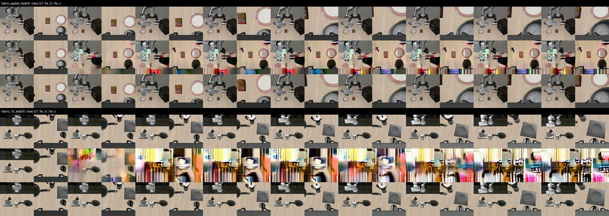
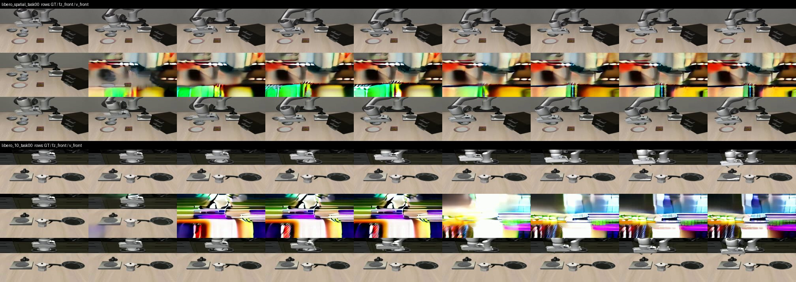

# Robot VLA WAM Practice

这是一个以 LeRobot 为工作流层的机器人操作实验仓库。当前 README 总结
`LIBERO`、`PushT`、`SmolVLA`、`ManiSkill` 四条实验线，以及 WAM 文献复现与迁移路线。

完整实验命令、协议和产物位置见 [`reports/guides/`](reports/guides/README.md)，实际运行记录见
[`reports/experiment_log.md`](reports/experiment_log.md)。本页不把计划、Smoke 或诊断结果写成
Formal 结论。

> 说明：LIBERO 是 benchmark。下面的“LIBERO”章节指 ACT 在 LIBERO 上的实验；“SmolVLA”章节
> 是另一条在 LIBERO-Goal 上进行语言条件适配的 VLA 实验线，两者的结果不能互相替代。

## 四条线与 WAM 路线的当前结论

| 项目 | 目的 | 当前结论 |
| --- | --- | --- |
| LIBERO / ACT | 验证 ACT 的训练、动作 chunk、平滑控制和 LIBERO 闭环能力 | A1-VAE 达到 19/20（95%），A2 + Temporal Ensemble 达到 18/20（90%）；当前证据只覆盖单任务、单 seed |
| PushT | 研究 Diffusion 的随机闭环行为、采样效率和条件控制 | 完整 DDPM sampling 能产生多个成功闭环 mode；DDIM-5 是当前最佳速度配置，但固定 observation 多峰性、Prototype-ID 和 Route Field 语义控制均未建立 |
| SmolVLA | 验证 LIBERO 域适配、LoRA、paraphrase 和语言目标服从 | C3 selected `015000` 达到 canonical 88/90、held-out paraphrase 67/90、Prompt Swap 首次达成 30/30；background regression 为 0/210，而 B0 基线为 183/210，当前配置仍有严重 background forgetting |
| ManiSkill | 验证 PickCube/StackCube 的数据、控制协议、Action-only Flow 和官方 Diffusion Policy 参照 | M0 PickCube 的 4D/CPU 固定 holdout 为 397/400（99.25%）；StackCube 主表按数据来源和 rollout contract 分组记录：官方 4D 默认 57D state 的 DP 在 100k 为 52/100 once、47/100 end；M2-W 50k 为 43/200、43/200；M2 Base + GPU 7D development 选中 step 30k 为 18/100；M2 Base + 投影 4D 的 held-out test 为 21/100。7D 投影 `[0,1,2,6]` 的全量 replay 为 911/987 once、844/987 end；不同组不组成单一排行榜 |
| WAM 文献复现 | 先在 LIBERO 复现 Fast-WAM/Light-WAM 的公开 artifact 与机制，再迁移到 StackCube tiny 对照 | W0 Fast-WAM 的 released/integration 闭环与本地 `FW-V`/`FW-FZ` 对照均已完成：UP-REL `1929/2000`（96.45%）、LR-REL `1885/2000`（94.25%）、FW-V `1921/2000`（96.05%）、FW-FZ `1743/2000`（87.15%）。该评测不是 held-out 泛化（初始配置与训练重叠 85.6%）；deployment 测量仍未完成，W0 不设 pass/fail 阈值，是否继续 W1/W2/W3 由测量结果判断 |

## 1. LIBERO：ACT 子任务总结

固定闭环对照主要使用 `libero_object/task 8`、20 个初始状态、10 Hz；除特别注明外，结果为
单个 training seed。ACT 的完整协议见 [ACT 实验指南](reports/guides/act/README.md)。

| 子任务 | 目的 | 结论 |
| --- | --- | --- |
| [A-Sanity](reports/guides/act/act_a_sanity.md) | 确认 ACT 能在少量 demonstration 上完成训练、离线预测和 LIBERO 闭环执行 | **已完成。** 20k 模型达到 18/20（90%）闭环成功；训练管路已打通，但没有保留 zero-update checkpoint 和完整 loss 日志，不能作为严格 B0→20k 因果对照 |
| [A0/A1 Action Chunking](reports/guides/act/act_action_chunking.md) | 在相同数据和训练预算下，比较单步预测与 action chunk 是否能保持成功率并改善动作连续性 | **已完成正式对照，但结果不支持预设假设。** 同数据、同 seed、同 20k updates、同 `n_action_steps=1` 重规划下，A0 为 9/20（45%），A1 为 4/20（20%）；A1 的 offline first-action MAE 降低 17.2%，但闭环 Action Jerk 上升 26.7%。A1 默认 `n_action_steps=5` 时为 3/20（15%）。单任务、单 seed，且未保留 step-0 checkpoint 和完整 loss 曲线 |
| [A2 Delta-action Loss](reports/guides/act/act_delta_action_loss.md) | 用相邻动作差分损失改善动作拟合、动作平滑性和闭环稳定性 | **支持该变体有效。** 在当前任务和 seed 上，success 从 A1 的 15% 提升到 70%，Action Jerk 降低 20.3%；没有 shared step-0 checkpoint 且只有一个 seed，不能外推为模型家族结论 |
| [A3 Temporal Ensemble](reports/guides/act/act_temporal_ensemble.md) | 用历史 action chunk 集成缓解每步重规划抖动并提高闭环成功率 | **支持组合配置有效。** A1 replan 从 4/20 提升到 18/20，A2 standard 从 14/20 提升到 18/20，Jerk 显著下降；A2 的无 Ensemble replan control 尚未补跑，不能隔离 Ensemble 的纯因果贡献 |
| A1-ObsEqual（[指南](reports/guides/act/act_observation_equal_and_vae.md)） | 让 episode 尾部 observation 获得与其他 observation 相同的监督权重 | **支持末尾监督不足是假设来源。** success 从 15% 提升到 45%，动作连续性没有退化；证据仍限于单任务、单 seed 和 20 个初始状态 |
| A1-VAE（[指南](reports/guides/act/act_observation_equal_and_vae.md)） | 用 ACT VAE 建模 action chunk 的未来不确定性 | **当前 A1 家族最佳 clean 闭环配置。** success 达到 19/20（95%），TV、Jerk 和 gripper toggles 均优于 A1；尚未完成 offline evaluation，不能补写 open-loop 误差 |

## 2. PushT：Diffusion 子任务总结

固定数据为 206 条 episode：165 train、20 development、21 held-out audit；模型使用两帧
observation、16 步内部 horizon，实际每次执行 8 步。完整协议见
[PushT Diffusion Guide](reports/guides/pusht_diffusion/README.md)。

| 子任务 | 目的 | 结论 |
| --- | --- | --- |
| [Baseline / checkpoint selection](reports/guides/pusht_diffusion/benchmark.md) | 公平训练 BCChunk 与 Diffusion，并只用 development seed 选择后续实验使用的 checkpoint | 选中 BCChunk-150k（development 11/20）和 Diffusion-175k（16/20）；Diffusion 在该 selection workload 上更强，但单 training seed 且评测参与选模，不能作为独立 final 泛化结论 |
| [E0 Demonstration 审查](reports/guides/pusht_diffusion/e0_data_inspection.md) | 审查 206 条轨迹的几何、接近方向、旋转和重新接触行为，为固定 observation 实验选候选 | 识别出 33 个全局策略组，证明数据存在全局轨迹多样性；但全局分组不等于同一 observation 下的 action 多模态，E0 不能单独证明这一点 |
| [E1 Fixed-observation Sampling](reports/guides/pusht_diffusion/e1_fixed_observation.md) | 在完全相同的 observation 上分离 initial noise 与完整 DDPM reverse sampling 对 action chunk 的影响 | 完整 reverse sampling stream 会改变 action chunk，但 20 samples 的 GMM/BIC 与聚类判据均为 0/10 通过；未检测到固定 observation 下的多 mode，不能声称已克服 MSE mode averaging |
| [E2 Multi-seed Rollout](reports/guides/pusht_diffusion/e2_multi_seed_rollout.md) | 检查 sampling seed 是否能在相同初始环境中产生不同的成功闭环轨迹 | E2b 中 16/20 个环境出现至少两个成功 mode，`any@10=90%`；支持“Diffusion 有多个成功闭环行为 mode”，但不能证明固定 `p(a|o)` 本身是多峰分布 |
| [E3 Sampling Speed](reports/guides/pusht_diffusion/e3_sampling_speed.md) | 比较 DDIM/DDPM 去噪步数、闭环成功率和 end-to-end latency | **DDIM-5 是当前最佳部署配置。** success 为 29/50（58%）、end-to-end p95 为 47.7 ms；相对 DDPM-100 的 60% 和 600.1 ms 加速 12.57×，但不能宣称严格等价或完成 non-inferiority 证明 |
| [E4 Rotation / Contact OOD](reports/guides/pusht_diffusion/e4_rotation_only.md) | 检查未适配的 Diffusion policy 是否能处理同中心纯旋转和不同初始接触几何 | 纯旋转 0/5，三种 contact offset 各 0/5；结果支持接触几何敏感，不支持固定 observation 下已有可用的左右旋转多模态；没有训练 E4 数据，不能评价 E4 训练能力 |
| [E5 Prototype-ID](reports/guides/pusht_diffusion/e5_mode_conditioned.md) | 用 trajectory prototype 作为显式 condition，验证模型能否按请求选择不同完整行为 | condition ID 确实改变 action chunk，但 requested→achieved prototype 矩阵不是对角，Mode-Diffusion P0/P1/P2 adherence 仅 14.3%/28.6%/19.0%；任务能力保留，但没有建立可靠 semantic prototype control |
| [E6 / RF7 Route Field](reports/guides/pusht_diffusion/e6_route_field_7x7.md) | 用 7×7 route field 显式控制路线的占用、进度和方向 | condition 被模型读到，但没有被当作可执行顺序指令；GT route oracle 仅 1/21，reversed/permuted 服从度为 0。无同状态配对监督、route family 稀疏是主要根因候选，负结论的可判定样本仍偏少 |

## 3. SmolVLA：LIBERO-Goal 子任务总结

SmolVLA 线固定使用 LIBERO-Goal 目标任务 1/4/8、两路 256×256 RGB、8 维 state、7 维相对
末端动作、10 Hz；目标训练集为 113 条 demonstration，正式目标协议为 90 条 canonical、
90 条 held-out paraphrase 和 30 条 Prompt Swap。

| 子任务 | 目的 | 结论 |
| --- | --- | --- |
| [准备与 Smoke](reports/guides/smolvla_libero/00_preparation.md) | 验证 LeRobot、LIBERO、SmolVLA、PEFT、双相机、state/action processor 和闭环 evaluator 能连通 | 环境、CUDA/BF16、C0 完整 episode Smoke、本地 PEFT 加载和首动作检查通过；instrumented LoRA Smoke 尚未闭合，因此 Phase 0 不能写成全部完成 |
| [数据、provenance 与 split](reports/guides/smolvla_libero/01_data_preparation.md) | 冻结 B0 背景 split、目标 Train/Validation/Test split 和 paraphrase 语料，并验证数据不泄漏 | 143/143 个目标 episode 唯一映射到 raw demonstration，action 误差全为 0，目标 Train/Validation 和 closed-loop split 互斥；数据契约成立，但这不等于模型结果成立 |
| [B0 Domain Adaptation](reports/guides/smolvla_libero/02_b0_domain_adaptation.md) | 用 37 个非目标任务把 SmolVLA 适配到 LIBERO 域，并保留背景任务能力 | selected `025000` 达到 background validation 121/140、held-out test 183/210（87.1%）；B0 域适配有效，但 held-out 只针对未见 init state，不是跨任务泛化 |
| Z0 Target Zero-shot（[统一评测](reports/guides/smolvla_libero/06_evaluation.md)） | 直接测试 B0 对三个目标任务的零样本迁移能力 | canonical 0/90、held-out paraphrase 2/90、Prompt Swap 0/30；当前设置下目标任务 adaptation 是必要的 |
| [C1 Default Non-PEFT](reports/guides/smolvla_libero/03_c1_non_peft.md) | 从同一个 B0 出发用目标 canonical demonstration 做普通参数适配 | canonical 87/90、held-out paraphrase 30/90、Prompt Swap 29/30，但 background 0/210；C1 学会了目标任务，却出现严重语言泛化缺口和 catastrophic forgetting |
| C1 scaled-LR diagnostic（[报告](reports/2026-08-06-C1学习率缩放遗忘权衡诊断结论.md)） | 检查按 global batch 缩放学习率能否缓解 C1 遗忘 | 最佳 step 10k 为目标 58/60、background 55/210；只能部分缓解，远低于 B0 的 183/210，且不替换正式 C1 |
| C1 background replay diagnostic（[报告](reports/2026-08-06-C1遗忘诊断与背景数据回放结论.md)） | 检查在目标训练中加入 background replay 是否比单独降 LR 更能保留旧能力 | `k=4/8` selected step 20k 为目标 59/60、background 149/210；replay 比降 LR 有效，但训练已见 background，不能等同纯 retention，`k=2/8` 和 `k=6/8` 尚未执行 |
| [C2 Canonical LoRA](reports/guides/smolvla_libero/04_c2_canonical_lora.md) | 在同一 B0 和 canonical 数据上，用 rank-32 LoRA 替代 C1 的 Non-PEFT 适配 | canonical 87/90 与 C1 打平，held-out paraphrase 降到 19/90，background 仅 8/210；LoRA 没有改善语言泛化，也没有防住遗忘 |
| [C3 LoRA + Paraphrase](reports/guides/smolvla_libero/05_c3_paraphrase_lora.md) | 用 25% canonical + 75% train paraphrase 改善未见语言表达下的目标执行 | selected `015000` 达到 canonical 88/90、held-out paraphrase 67/90、Prompt Swap 首次 30/30；background regression 为 0/210（B0 为 183/210），目标语言泛化改善但 background forgetting 仍未解决 |
| [Prompt Swap 口径修复](reports/2026-08-06-PromptSwap修复后合并结果.md) | 修正目标首次达成后 reset 导致的错误判定，区分首次达成和 terminal hold | 修复后应只引用 first-goal：Z0 0/30、C1 29/30、C2 28/30、C3 30/30；C3 terminal hold 29/30，说明达成后的保持仍有一条失败 |

## 4. ManiSkill：按阶段的实测结果

ManiSkill 线使用独立的 data provenance、controller、sim backend 和 rollout contract。完整命令、
产物位置和设备边界见 [ManiSkill 实验指南](reports/guides/maniskill/README.md)。下面的结果只引用
已经落盘的训练或评测产物；`Smoke`、协议 replay 和训练集 probe 不冒充独立泛化结果。

StackCube 的 GPU state-bank 结果统一是 development 200 states、最多 500 steps、`physx_cuda`；
官方数据的 CPU 结果是 `physx_cpu`，除 RGB anchor 特别注明外为 200 episodes、最多 200 steps。
官方 DP 的 native-4D/7D GPU exact-state 评测中 200 条轨迹均跑到 truncation，因此
`success_at_end=0`；主比较指标使用 `success_once`，不能把它误读成“从未完成过任务”。M2-W
使用自己的 evaluator，当前最佳 development candidate 为 step 50k、`n_action_steps=8`，
`success_once/success_at_end=43/200`。

### 4.1 数据与协议阶段

| 子任务 | 实测结果 | 结论 |
| --- | --- | --- |
| [M0 PickCube RL 7D](reports/guides/maniskill/00_m0_pickcube.md) | 1,013 demos、50,360 frames；20k checkpoint development 为 120/200（60.0%），当时独立 test 为 234/400（58.5%）；50k 在同一 test block 上 sweep 的峰值为 340/400（85.0%） | 7D/GPU 学生管路确实能学会，但 50k test sweep 已污染该 test block，只能作诊断，不能再用于选模或正式泛化结论 |
| [M0 PickCube 4D 论文参照](reports/guides/maniskill/01_paper_aligned_pickcube_4d.md) | motion-planning、4D `pd_ee_delta_pos`、CPU、horizon 100；1,000-demo 固定 holdout 为 397/400（99.25%），100-demo 为 206/400（51.5%） | LeRobot diffusion、CPU rollout 和官方 success 语义已达到可用基线；不能与 M0 的 7D/GPU 结果直接相减 |
| [M1-W StackCube 数据协议](reports/guides/maniskill/02_m1_w_protocol_audit.md) | GPU-native 7D source 1,000 条；baseline replay 805/1,000，failed-only repair 恢复 182/195；final live-RGB `D_core` 为 987 episodes、106,528 action frames，7D replay 987/987 success-at-end；同一 source 投影为 `[0,1,2,6]` 的 4D 全量 replay 为 911/987 success-once、844/987 success-at-end；state bank train/development/test 为 2,000/200/400，split leakage 为 0 | **数据链已完成并冻结。** RGB、18D proprioception、7D action、env state、fingerprint 和 frozen protocol gate 均通过；4D 投影 replay 也证明动作投影本身大部分可执行。M1-W 本身是数据/协议结果，不是 learned-policy 成绩 |
| [M1-W 原生 4D 数据](reports/guides/maniskill/12_m1_w_native_4d_data.md) | 官方 CPU joint→4D conversion 1,000/1,000；GPU native-4D baseline 760/1,000；repair 的 success-at-end 为 186/240（success-once 213/240）；accepted merge 946 条；最终实时 RGB replay 946/946 success-at-end | 4D 数据是重新转换并在 GPU controller 下验证过的独立数据链，不是从 7D 标签切片；它足以进入模型对照，但不能单独证明“动作维度”是唯一因果因素 |
| [M1-R Policy Decorator MS2/v2 协议预检](reports/guides/maniskill/03_m1_r_protocol_audit.md) | ManiSkill2 0.5.3、pinned Policy Decorator、`PegInsertionSide-v0` metadata / `PegInsertionSide-v2` runtime、原生 7D EEF action、50D state；source/environment audit 与 exact-replay smoke 已完成 | 50 条 native/strict replay 均 `50/50`；full replay、D_core、state banks 和 protocol freeze 尚未执行。Plug 的 actual-EEF retarget 仍是独立历史诊断，不进入 M1-R 或 StackCube learned-policy 对照 |

### 4.2 StackCube 模型对照子表

这是位于 M1-W 数据协议之后的总表；`official 模型复现` 作为其中一个阶段分组出现，不再单独
重复一张表。完整 official 协议、命令和 legacy 100-demo runner 说明见
[官方 StackCube RGB Golden Anchor 指南](reports/guides/maniskill/07_official_stackcube_rgb_anchor.md)。
表格采用“协议/数据阶段 → 模型 + 数据 → 训练与闭环结果”的层级记录，第一列按阶段合并，避免
把不同数据来源和 rollout contract 看成一条无条件排行榜。

<table>
<thead>
<tr>
<th>协议 / 数据阶段</th>
<th>模型 + 数据</th>
<th>训练与闭环结果</th>
</tr>
</thead>
<tbody>
<tr>
<th rowspan="5">M1-W StackCube 数据协议</th>
<td><a href="reports/guides/maniskill/04_m2_w_action_only_flow.md">M2-W Action-only Flow + M1-W GPU 7D 数据</a></td>
<td><strong>50k steps</strong>；GPU development 200 states / horizon 500；<code>success_once / success_at_end = 43/200 / 43/200</code>（21.5% / 21.5%）。candidate 为 step 50k、<code>n_action_steps=8</code>；test 未访问。</td>
</tr>
<tr>
<td><a href="reports/guides/maniskill/09_m2_base_action_flow.md">M2 Base Action-only Flow + M1-W GPU 7D 数据</a></td>
<td><strong>50k steps / 4-GPU DDP</strong>；GPU development 100 states / horizon 200；selected step 30k、<code>n_action_steps=8</code>；<code>18/100 / 18/100</code>（18.0% / 18.0%）。</td>
</tr>
<tr>
<td><a href="reports/guides/maniskill/09_m2_base_action_flow.md">M2 Base Action-only Flow + M1-W 7D 的 projected 4D success-at-end 数据</a></td>
<td><strong>50k steps / 4-GPU DDP</strong>；监督 action 只取 <code>[0,1,2,6]</code>，GPU development 100 states 选中 step 50k、<code>n_action_steps=8</code> 为 <code>22/100 / 22/100</code>；held-out test 为 <code>21/100 / 21/100</code>。</td>
</tr>
<tr>
<td><a href="reports/guides/maniskill/06_m2_diffusion_policy.md">LeRobot Diffusion Policy + M1-W GPU 7D 数据</a></td>
<td><strong>50k steps</strong>；GPU development 200 states / horizon 500；<code>success_once / success_at_end = 19/200 / 19/200</code>（9.5% / 9.5%）。</td>
</tr>
<tr>
<td><a href="reports/guides/maniskill/10_official_dp_m1w_7d.md">official Diffusion Policy + M1-W GPU 7D 数据</a></td>
<td><strong>50k steps</strong>；GPU development 200 states / horizon 500；<code>success_once / success_at_end = 27/200 / 0/200</code>（13.5% / 0%）。train loss <code>0.0021</code>。</td>
</tr>
<tr>
<th rowspan="3">official 模型复现</th>
<td><a href="reports/guides/maniskill/07_official_stackcube_rgb_anchor.md">official Diffusion Policy + 官方 motion-planning 4D replay（单卡主 anchor）</a></td>
<td><strong>50k / 100k steps</strong>；官方默认 <code>agent + extra</code>，实际 57D state；CPU verification 100 episodes / horizon 200：50k 为 <code>34/100 / 33/100</code>（34.0% / 33.0%），100k 为 <code>52/100 / 47/100</code>（52.0% / 47.0%）。</td>
</tr>
<tr>
<td><a href="reports/guides/maniskill/07_official_stackcube_rgb_anchor.md">official Diffusion Policy + 同一官方 motion-planning 4D replay（4-GPU DDP）</a></td>
<td><strong>同一 990-demo 数据、100k steps / GPU 4,5,6,7</strong>；同一默认 57D state、4D action 和 CPU verification contract；global batch <code>256</code>；<code>success_once / success_at_end = 48/100 / 45/100</code>（48.0% / 45.0%）。仅训练并行方式不同，不替代单卡 100k anchor。</td>
</tr>
<tr>
<td><a href="reports/guides/maniskill/11_official_dp_18d4_ablation.md">official Diffusion Policy + 同一官方 motion-planning 4D replay + 显式 18D state</a></td>
<td><strong>同一官方 motion-planning 4D replay 来源；state 改为显式 18D qpos+qvel；本 run 50k steps、787 demos</strong>；CPU development 200 states / horizon 200；<code>success_once / success_at_end = 67/200 / 54/200</code>（33.5% / 27.0%）。train loss <code>0.00109</code>。数据来源相同，但 demos、state extractor 和 eval contract 不同，因此不是严格单变量 ablation。</td>
</tr>
<tr>
<th rowspan="2">M1-W 原生 4D 数据</th>
<td><a href="reports/guides/maniskill/12_m1_w_native_4d_data.md">official Diffusion Policy + M1-W 原生 4D 数据</a></td>
<td><strong>50k / 100k steps</strong>；GPU development 200 states / horizon 500：50k 为 <code>100/200 / 0/200</code>（50.0% / 0%），100k 为 <code>103/200 / 0/200</code>（51.5% / 0%）。它不是官方 motion-planning 4D replay。</td>
</tr>
<tr>
<td><a href="reports/guides/maniskill/09_m2_base_action_flow.md">M2 Base Action-only Flow + M1-W 原生 4D 数据</a></td>
<td><strong>100k steps / 4-GPU</strong>；global batch <code>256</code>；step 100k、<code>n_action_steps=4</code> 被选中；train mean tail loss <code>0.02532</code>。GPU development：<code>83/95 / 83/95</code>（87.4% / 87.4%）；post-selection test：<code>82/96 / 82/96</code>（85.4% / 85.4%）。<a href="outputs/maniskill/m2_base_action_flow/m1w_native_rgb_4d/formal_seed1000_100k/development_gpu/selected_checkpoint.json">selected checkpoint</a> · <a href="outputs/maniskill/m2_base_action_flow/m1w_native_rgb_4d/formal_seed1000_100k/test_gpu/metrics.json">test metrics</a></td>
</tr>
</tbody>
</table>

### 4.2.1 尚未形成正式结果的适配

| 实验 | 训练 budget | 数据 / eval | success_once / success_at_end | 为什么单列 |
| --- | ---: | --- | ---: | --- |
| [M2 base 官方 motion-planning RGB 4D 适配](reports/guides/maniskill/09_m2_base_action_flow.md) | — | 4D/7D head、H5 lazy loader 和 config/smoke gate；不含已完成的 M1-W projected/native-4D route | N/A | 官方 RGB 4D 这条通用适配入口尚未形成正式训练+选模结果；M1-W projected/native-4D 结果已在上方主表单列 |

### 4.2.2 表格的比较规则

- 先在 `M1-W StackCube 数据协议` 组内区分 M2-W formal、M2 Base 7D/投影 4D、LeRobot DP 和
  official DP；M2 Base 的 7D 与投影 4D 训练 steps、split 和 GPU rollout contract 已对齐，仍需
  将数据监督和 input provenance 作为解释变量。
- 在 `official 模型复现` 组内比较官方 4D/57D 单卡 50k→100k；4-GPU DDP 只作为同一 100k
  配置的工程变体，不与单卡预算曲线合并。
- `M1-W 原生 4D 数据` 组用于区分数据 provenance；它不能直接替代 official motion-planning 4D
  replay，也不能把 native-4D 的结果解释成动作维度的单变量结论。
- `[0,1,2,6]` 全量 replay 是协议/数据诊断，不是 learned-policy 结果；它证明投影 action 在
  `physx_cuda` 下大部分可执行，但不能证明 policy 能从对应 RGB/state 恢复该 action。
- 每个结果单元格必须同时能追溯到“训练 steps + eval backend + split + episodes + horizon”；
  缺任一关键字段时写 `N/A` 或“未完成”，不从训练内 monitor 推断独立泛化结果。

## 5. WAM 文献锚点与 StackCube 迁移路线

WAM 路线与 ManiSkill learned-policy 结果分开记录。W0/W1 是 LIBERO 上的文献模型复现，W2/W3
才回到 StackCube tiny 对照；在 W0/W1 的 artifact、机制和 deployment gate 通过前，不创建
StackCube formal WAM 结果，也不把论文或上游 README 的数字写成本地测量。

### W0 Fast-WAM baseline

W0 的 released baseline 是上游 released Fast-WAM checkpoint 的本地正式闭环评测（`UP-REL`）；
`FW-V`/`FW-FZ` 是本地训练的机制对照，不能与 released/integration 结果混成同一组。固定 40 个
LIBERO tasks、每个 task 50 trials，共 2,000 episodes；无缺失或重复 trial。

> **评测口径说明（重要）**：LIBERO 的闭环评测**不是 held-out 泛化测试**。评测的 2,000 个初始
> 状态来自 LIBERO 原始的 `<task>.pruned_init`（每 task 恰好 50 条），而训练 demonstration 的
> 起始配置来自同一来源，实测重叠 **85.6%**（训练集 1,712 episodes / 评测 2,000 初始状态）。
> 剩下 288 个未覆盖的 trial 不是刻意留出的 test split，而是 OpenVLA 在构建 `_no_noops` 数据集
> 时**重放失败被剔除**的 demonstration（论文 Appendix E.1），评测端不做对应过滤。所以这里的
> success 衡量"能否从训练见过的初始配置重新执行"，与所有已发表 LIBERO 数字同口径、可比，
> 但不能读成对新物体摆放的泛化。明细见
> [`outputs/literature/w0_fastwam/train_eval_overlap.json`](reports/guides/literature/01_w0_fastwam_libero.md)。

| 模型 / 评测变体 | 数据与协议 | 正式闭环结果 | 状态 |
| --- | --- | ---: | --- |
| Fast-WAM W0 `UP-REL` released checkpoint | LIBERO-10 / Goal / Object / Spatial；front + wrist RGB、8D proprio、7D action；上游 checkpoint + 上游 evaluator | **1929/2000（96.45%）**；LIBERO-10 `467/500`（93.4%）、Goal `488/500`（97.6%）、Object `498/500`（99.6%）、Spatial `476/500`（95.2%） | **baseline 已完成**；本地 causal pair 与 deployment gate 独立记录 |
| Fast-WAM W0 `LR-REL` LeRobot integration | 同一 released checkpoint、同一 40 tasks × 50 trials；改用 pinned LeRobot evaluator | **1885/2000（94.25%）**；Object `500/500`（100.0%）、Goal `479/500`（95.8%）、LIBERO-10 `462/500`（92.4%）、Spatial `444/500`（88.8%） | **已完成。** 相对 UP-REL 的 −2.2pp 几乎全部集中在 `libero_spatial` task 5（UP 96% vs LR 28%），其余 39 个 task 在 ±8pp 内；该缺口**未解释**，不补填归因 |
| Fast-WAM W0 `FW-V` 本地训练 checkpoint | 同一 40 tasks × 50 trials；本地从 Wan2.2 预训练权重训练 10 epoch / 21,700 步，`lambda_video=1.0`，video expert 可训；上游 evaluator | **1921/2000（96.05%）**；Object `499/500`（99.8%）、Spatial `486/500`（97.2%）、Goal `483/500`（96.6%）、LIBERO-10 `453/500`（90.6%） | **已完成。** 与 UP-REL 的 −0.4pp 在 n=2000 的二项 σ≈0.44pp 之内，统计上不可区分；相对论文 97.6% 低 1.55pp，缺口未解释。与 `FW-FZ` 的本地差值为 **+8.90pp** |
| Fast-WAM W0 `FW-FZ` 本地训练 checkpoint | 同一 40 tasks × 50 trials；本地从同一 Wan2.2 初始化训练 10 epoch / 21,700 步，`lambda_video=0`，video expert 冻结；上游 evaluator | **1743/2000（87.15%）**；Object `469/500`（93.8%）、Spatial `468/500`（93.6%）、Goal `440/500`（88.0%）、LIBERO-10 `366/500`（73.2%） | **已完成。** 257 次失败；31/40 tasks 至少有一次失败。相对 `FW-V` 为 **−8.90pp**；LIBERO-10 差值最大，为 **−17.4pp** |

结果明细见 [W0 Fast-WAM 指南](reports/guides/literature/01_w0_fastwam_libero.md) 及
`outputs/literature/w0_fastwam/upstream_released/summary.json`、
`outputs/literature/w0_fastwam/lerobot_released_visualfix/summary.json`、
`outputs/literature/w0_fastwam/eval_fwv_21700_4gpu/summary.json`、
`outputs/literature/w0_fastwam/eval_fwfz_21700_4gpu/summary.json`。

论文 Table 2 的 `Fast-WAM` vs `Fast-WAM w.o. video co-train`（FW-NV）与本地 `FW-V` vs `FW-FZ`
的差值如下；所有差值均为 with-video − no-video，`Long` 对应本地 `libero_10`：

| 对照差值 | Spatial | Object | Goal | Long / LIBERO-10 | Average / Overall |
| --- | ---: | ---: | ---: | ---: | ---: |
| 论文：Fast-WAM − FW-NV | **+9.0pp** | **+0.8pp** | **+1.6pp** | **+5.2pp** | **+4.1pp** |
| 本地：FW-V − FW-FZ | **+3.6pp** | **+6.0pp** | **+8.6pp** | **+17.4pp** | **+8.90pp** |

论文 FW-NV 只移除 video co-training objective；本地 FW-FZ 同时设置 `lambda_video=0` 并冻结
video expert，因此本地差值是复合机制对照，不能直接视为纯 video co-training 的因果增益。
论文来源：[Fast-WAM Table 2 / Sec. 3.3](https://arxiv.org/pdf/2603.16666)。

### W0 离线视频生成对照（后验记录，不进入上面的闭环表）

W0 的对外结论只用闭环成功率。下面这组是**后验**测量：同一对 checkpoint 在 LIBERO 未来帧上的离线
重建指标，用来回答「`FW-V` 的视频分支到底有没有学到东西」，不作为 W0 的机制结论或通过依据。协议为
W0-Video-40：四个 suite 各 10 task、每 task 1 条 33 帧窗口取 9 帧，条件输入是 front + wrist 各
`224x224` 横向拼接的 `448x224`，指标只算 future frame `[1..8]`，拆两相机后等权平均。两个变体共用同一
manifest 与 protocol，各 40/40。

| 变体 | PSNR ↑ | SSIM ↑ | LPIPS ↓ |
| --- | ---: | ---: | ---: |
| `FW-FZ`（`lambda_video=0`、video expert 冻结） | 9.963 | 0.2040 | 0.6822 |
| `FW-V`（`lambda_video=1`、video expert 可训） | **24.705** | **0.9231** | **0.0983** |
| 差值（LPIPS 为 FZ−V，正值均代表 `FW-V` 更好） | **+14.742** | **+0.7190** | **+0.5839** |

每条带三行：GT / `FW-FZ` / `FW-V`，横向 frame 0→8；frame 0 是给定的条件帧，所以三行相同。

**可支持的结论**：`FW-V` 的视频分支确实学到了域内动力学，没有塌缩——24.705 dB 距本管路上限
（条件帧走一遍 VAE 与 mp4 往返，实测 33.8–35.7 dB）约 10 dB，且分布集中，35/40 条 SSIM >0.85。

**不可支持的结论**：不能读成「video co-training 提升了视频生成能力」。`FW-FZ` 的 video expert 是
未训练过的 Wan2.2 权重，且运行在四个同时偏离其预训练的设置上（并排双相机布局、`448x224` 即每帧仅
`14x28=392` 个 latent token、9 帧对原生 81、`first_frame_causal` 对 DiT 类默认 `bidirectional`），
所以该差值把「学过这个任务」与「跑在有效工作点上」混在一起，按构造接近同义反复。要回答通用生成
能力的保持性，需要 VBench-I2V-mini-21——那里 `FW-FZ` 等于未受损的 Wan2.2，构成保持度上界；该组尚未
执行。样本窗口取自训练 demonstration，属分布内拟合，不是 held-out 泛化。

**已排除的解释**：把条件输入换成单个 `224x224` front 视角后（同 3 条样本、拼接组只取 front 半幅
以同口径比较），`FW-FZ` 从 10.338 dB / SSIM 0.1462 变为 9.975 dB / 0.1859，**基本不变**；而同一个
布局变化让 `FW-V` 从 26.098 dB 降到 22.011 dB（−4.087 dB）却依然完好。一次真实的分布偏移对训练过的
expert 只值 4 dB，因此「双相机拼接布局 OOD」不能解释 `FW-FZ` 的崩塌，已从候选原因中排除。

指标定义与方向、逐条排除过程（采样步数、checkpoint 加载、生成管路均已排除）见
[W0 视频生成保持性 guide](reports/guides/literature/02_w0_wan_video_generation_preservation.md)；
实测记录见 [`reports/experiment_log.md`](reports/experiment_log.md) 的 2026-08-25 两条。指标产物在
`outputs/literature/w0_fastwam/video_generation/w0_video_40/{fw_fz,fw_v}/metrics.json`（gitignored）；
上面两张图是**已提交**的文档资产，位于
[`docs/assets/w0_video_generation/`](docs/assets/w0_video_generation)，各约 300 KB，重建命令写在
guide 里。

| 阶段 | 目的 | 当前状态 | 入口 |
| --- | --- | --- | --- |
| W0 Fast-WAM / LIBERO | released checkpoint、LeRobot integration，以及同初始化的 `FW-V` vs `FW-FZ`（冻结 video expert 的 VLA 形状对照）主对照，`FW-NV`（`lambda_video=0`）作为可选的文献交叉验证 | **四条闭环已完成，FW-V/FW-FZ 对照已完成，deployment gate 待完成。** UP-REL `1929/2000`（96.45%）、LR-REL `1885/2000`（94.25%）、`FW-V` `1921/2000`（96.05%）、`FW-FZ` `1743/2000`（87.15%）；W0 不设 pass/fail 阈值 | [W0 guide](reports/guides/literature/01_w0_fastwam_libero.md) · [W0 plan](plans/2026-08-17-W0-Fast-WAM-LIBERO复现与机制锚点.md) |
| W1 Light-WAM / LIBERO | full latent 与 2× compressed latent 的能力、效率和显存对照 | **blocked**，等待 W0 mechanism/deployment gate | [WAM route plan](plans/2026-08-17-WAM文献锚点复现与StackCube迁移路线.md) |
| W2 StackCube tiny aligned comparison | 在同一 action path/budget 下比较 action-only、Fast-WAM-aligned 和 Light-WAM-aligned auxiliary supervision | **blocked**，等待 W0/W1 机制冻结；只允许 development | [WAM route plan](plans/2026-08-17-WAM文献锚点复现与StackCube迁移路线.md) |
| W3 StackCube one-shot formal | 打开 400-state formal bank，比较 W2 预注册的 checkpoint/claim | **blocked**，不提前访问 formal bank | [WAM route plan](plans/2026-08-17-WAM文献锚点复现与StackCube迁移路线.md) |

旧的 Mini-WAM / latent action-conditioning W0-W3 计划已 dropped，不作为当前路线的备用结果。

## 6. Residual RL 待进行实验

这张表沿用上面的“实验 → budget → 数据/eval → success → 单列原因”格式。M1-R 是 Residual
训练的前置协议 gate；后续实验都固定使用 Policy Decorator 的 ManiSkill2 0.5.3 / repo-local
`PegInsertionSide-v2` runtime 和 metadata 为 `PegInsertionSide-v0` 的原生 7D EEF 数据，不复用
M1-W 的 ManiSkill3 StackCube 数据。当前所有 success 单元格均为 `N/A`，因为这些实验尚未形成正式
learned-policy 结果。

| 实验 | 训练 budget | 数据 / eval | success_once / success_at_end | 为什么单列 |
| --- | ---: | --- | ---: | --- |
| [M1-R protocol freeze](reports/guides/maniskill/03_m1_r_protocol_audit.md) | —（协议 gate） | 986 条 Policy Decorator demonstrations；native/strict exact replay；D_core train/development/test 目标 `786/100/100`；state banks 目标 `2000/200/400` | `50/50` smoke 已完成；full `N/A` | 先冻结 commit、H5/JSON identity、v0-data/v2-env、50D state、7D action、TimeLimit、split 和 success/reward/termination；未完成前不能进入 M2-R |
| **M2-R：state Flow base + headroom** | 待子计划冻结 | 同一 986 条 native 7D 数据；low-dimensional 50D state-conditioned Flow-Matching；只在 development 选 base checkpoint，再用冻结 state bank 评测 | `N/A` | 先确认 base 高于 random、掌握 peg-to-hole 主体行为且保留 alignment/insertion headroom；这是 R0 的 frozen base，不是 Residual RL 结果 |
| **R0：Flow base + privileged-state residual** | 待子计划冻结 | 同一 MS2/v2 contract；base 预测 `16×7`，bounded residual 输出 `4×7`，每个 decision 执行 4 步；比较 Frozen Base、Flow + Residual、Zero Residual、Random Bounded Residual | `N/A` | 只验证 chunk-level residual recipe；预注册目标为相对 frozen base development `+10pp` 左右、多 seed 方向一致且 residual 不长期顶 bound；第一版不引入 RGB |
| **R1：visual / learned representation residual** | 待子计划冻结 | 保持 R0 的 task、action、controller、TimeLimit、split、SAC 和 `2/16/4/4`；只将 privileged state 替换为冻结视觉/学习表示 | `N/A` | 测试 perception/representation 迁移；目标是保留 R0 residual gain 的约 80%，不把视觉失败归因到 MS3 或重新生成一套 task contract |
| **R2：frozen SmolVLA + residual** | 待子计划冻结 | LIBERO 单任务；frozen SmolVLA/VLA action expert；residual 只读部署时可得的 visual-language embedding + robot state，VLA 参数不更新 | `N/A` | 验证 Policy Decorator-style residual 是否能作为 frozen VLA 的外挂 refinement；不与 ManiSkill2 的 R0 成绩直接横比 |
| **R3：Residual RL 算法归因** | 按相同真实 interaction budget 冻结 | 在同一 R2/目标 contract 下，对照 Residual RL、Online BC、Weighted BC、Residual BC；各方法允许自然 collection/exploration | `N/A` | 区分“在线新数据有用”和“Residual RL 的 reward/critic/exploration 算法额外有用”；未完成该对照不能声称 Residual RL 优于继续模仿学习 |

上述实验均属于待执行计划，不将 `M1-R` 的 50 条 smoke 写成训练结果。R0/R1/R2/R3 的完整
依赖关系、进入条件和停止条件见 [Residual RL 母计划](plans/2026-08-11-Mini-WAM与Residual-RL-完整实验总计划.md)。

## 7. ManiSkill 当前结论

- M0 已证明数据读取、Diffusion 训练、可视化和闭环评测管路可用；PickCube 的 4D/CPU 参照达到
  99.25%，所以后续 StackCube 的低分不是“整个 LeRobot diffusion 管路坏了”。
- M1-W 的 `D_core` 和 GPU live-RGB 数据协议已经通过；在同一 GPU 7D 数据上，M2-W 50k 为
  21.5%，LeRobot DP 50k 为 9.5%，官方 DP 7D 50k 为 13.5%。这说明模型/训练入口和泛化都需要
  继续追查，不能把差值归因给单一动作维度。
- 官方 4D CPU anchor 从 34%（50k）提升到 52%（100k），说明 StackCube 与官方 DP 都有继续
  训练的 headroom；M2-W 50k 的 21.5% 则主要暴露 train→development 泛化问题，而不是优化器没有下降。
- M2 Base 在 M1-W 原生 4D 数据上完成的 100k route 为 development `83/95`（87.4%），post-selection
  test `82/96`（85.4%）；它明显高于当前 M2-W 7D 的 50k 结果，但训练预算、数据 provenance、
  action/control contract 和 rollout split 同时变化，不能把提升单独归因于 action 从 7D 变成 4D。
- M2 Base 的同预算对照中，GPU 7D 选中 step 30k 为 `18/100`，投影 4D success-at-end route
  选中 step 50k 为 development `22/100`、held-out test `21/100`；它们都远低于 native 4D
  100k route，说明“投影后 replay 能成功”与“模型能学会跨轨迹的 RGB/state→action 映射”不是同一件事。
- 7D action 取 `[0,1,2,6]` 的全量 replay 为 `911/987` success-once、`844/987`
  success-at-end，因此当前不再把“4D 投影 action 本身不可执行”作为主解释。当前工作假设收敛为：
  7D 与 native 4D 的 RGB/state 轨迹和时间对齐不一致，削弱了 learned policy 的跨路线复制。
- 官方 18D/4D 50k 为 33.5% once、27.0% end；它与官方 57D/4D anchor 接近，但当前仍受
  demo 数、eval 数量和选模流程差异影响，不能视作已经完成的 57D→18D 单变量消融。
- 当前可引用的 StackCube learned-policy 数字必须同时带上 backend、数据来源、state-bank/seed
  split、horizon 和 success 口径；表格必须先按比较组分层，再看结果，不能把 CPU official、GPU
  native4d、GPU M1-W 7D、M2-W 和 LeRobot DP 合并成一张无条件排名表。

## 证据边界

- Guide 页面负责完整命令、协议、结果落点和复现条件；本 README 只保留“目的—结论”摘要。
- `Formal`、`Closed-loop`、`Offline`、`Smoke` 和 `Diagnostic` 不混写；没有正式测量的字段不补填数字。
- 单任务、单 seed、参与 checkpoint selection 的 validation 结果，只能支持对应实验范围内的判断，不能写成跨任务、跨 seed 或模型家族结论。
- ManiSkill 的 official 数据必须使用 CPU rollout，M1-W/native4d/M2-W/LeRobot DP 数据必须使用 GPU rollout；转换 backend 和正式 rollout backend 不混写。当前 4D/7D 对照受 split 与转换路径影响，只能作为诊断证据。
- WAM literature reference、W0 released-checkpoint baseline 和本地 StackCube W2/W3 结果必须分栏记录；
  W0 的 UP-REL baseline 可以写入实测 success，但不能把它扩展成 causal mechanism 或 deployment
  已通过的结论。
- W0 的离线视频生成指标（PSNR/SSIM/LPIPS）是后验记录，只支持“`FW-V` 的视频分支学到了域内动力学”
  这一观察；`FW-V − FW-FZ` 的视频差值是架构对比且按构造接近同义反复，不能写成 video co-training
  的机制证据，也不进入 W0 的闭环结果表。
- 计划仍放在 [`plans/`](plans/README.md)，实际结果仍放在 [`reports/`](reports/README.md)；数据、checkpoint、视频、Rerun recording 和日志等生成物不提交到 Git。

项目代码和文档使用 [Apache License 2.0](LICENSE)；第三方软件和数据集说明见
[`THIRD_PARTY_NOTICES.md`](THIRD_PARTY_NOTICES.md)。
