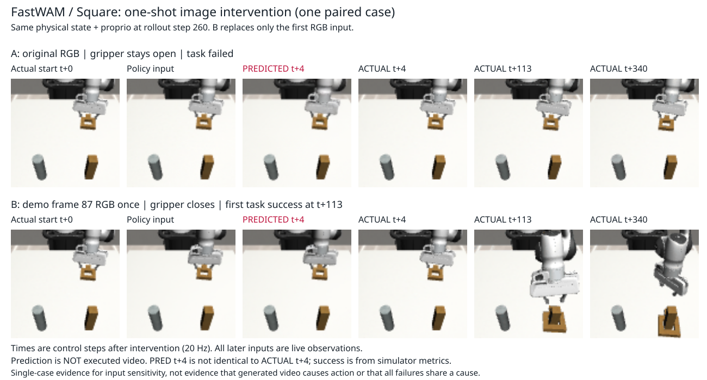
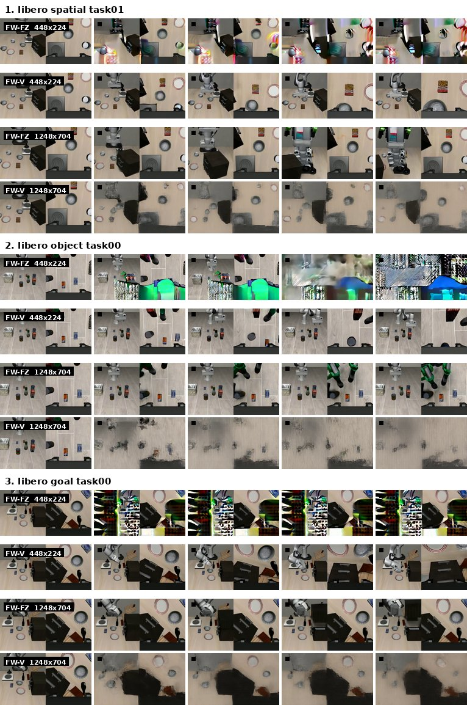
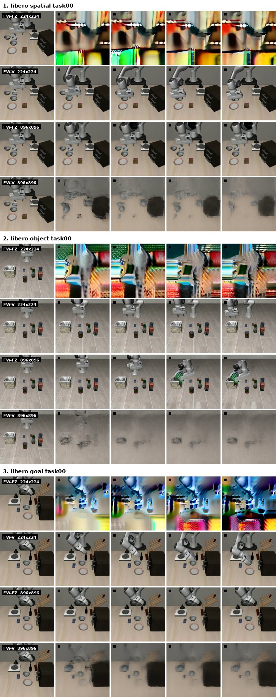
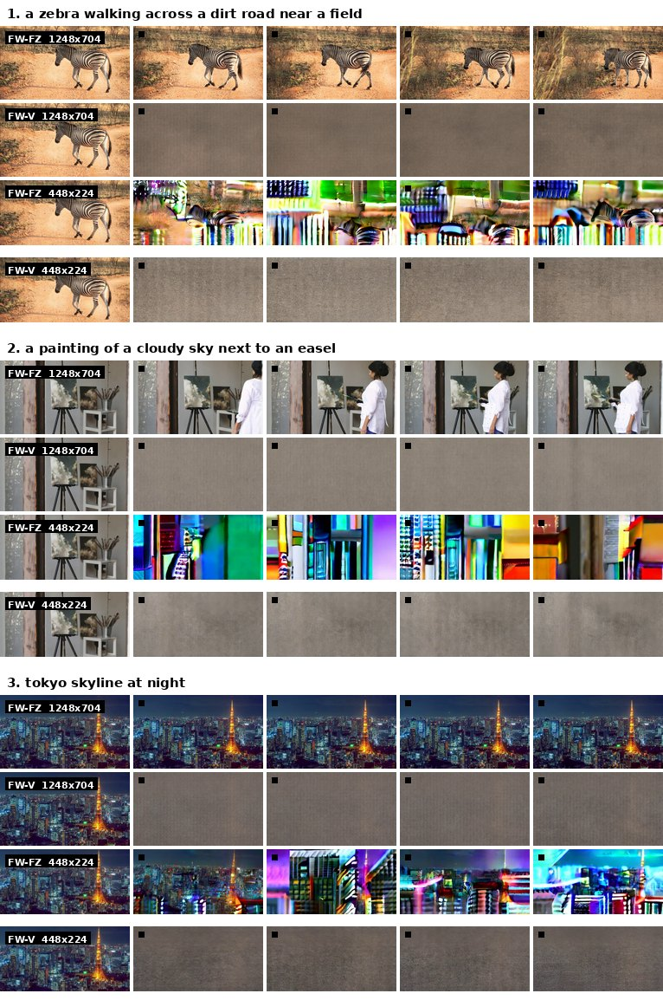

# Robot VLA WAM Practice

## 开源许可证与第三方使用要求

**本项目自有代码和文档采用 [Apache License 2.0](LICENSE)。第三方代码、补丁中的上游
内容、数据集、模型权重和机器人资产保留各自的许可证，不因存放在本仓库或被本项目调用
而统一变成 Apache-2.0。**

2026-09-23 核对了根许可证、已提交的第三方源码与补丁、对应上游许可证和来源记录：

| 内容 | 适用许可证与说明 |
| --- | --- |
| 项目自有实验代码、工具和文档 | Apache-2.0；允许依照条款使用、修改和分发，包括商业用途 |
| `third_party/maniskill_official/` | ManiSkill 的 Apache-2.0；其 Diffusion Policy 派生内容另保留原项目的 MIT 声明 |
| DPPO 配置补丁 | 上游 MIT；两处补丁目录均由同一份 DPPO 版权及许可声明覆盖 |
| FastWAM / Light-WAM 补丁 | 上游 MIT；各项目内部另有许可的第三方文件仍遵循其原许可 |
| LeRobot 相关补丁、gym-aloha 派生参数 | Apache-2.0；gym-aloha 来源中还需保留原 ALOHA 的 MIT 声明 |
| 下载的数据、预训练权重、仿真资产及其派生产物 | 单独检查对应版本的数据卡、模型卡、资产许可与再分发条件；本项目不另行授予这些权利 |

完整来源、版本和许可副本见 [THIRD_PARTY_NOTICES.md](THIRD_PARTY_NOTICES.md)。
分发源代码、二进制或包含依赖的 Docker 镜像时，应随附适用许可证，保留版权和归属声明；
Apache-2.0 派生文件须显著标明修改，并保留上游适用的 NOTICE 内容；MIT 内容须保留
版权与许可声明。引用论文不能代替履行许可证要求。
条款依据：[Apache-2.0 第 4 节](https://www.apache.org/licenses/LICENSE-2.0#redistribution)
及 [MIT License](https://opensource.org/license/mit)。

本次已补充上述直接纳入源码和补丁的许可说明。该核对不是所有传递依赖、镜像层、
模型权重和资产的完整法律审计，也不构成对整个实验产物可任意商用或再分发的保证。
新增或更新第三方内容时，须同时核对其具体版本的 LICENSE、NOTICE 和文件级声明。

## 项目概览

这是一个以 LeRobot 为工作流层的机器人操作实验仓库。当前 README 总结
`LIBERO`、`PushT`、`SmolVLA`、`Residual RL` 四条实验线，以及 WAM 文献复现与迁移路线；
`ManiSkill` 是这些实验共用的仿真 benchmark，它自身的数据/协议与模型对照结果记在第 4、7 节。

完整实验命令、协议和产物位置见 [`reports/guides/`](reports/guides/README.md)，实际运行记录见
[`reports/experiment_log.md`](reports/experiment_log.md)。本页不把计划、Smoke 或诊断结果写成
Formal 结论。

> 说明：LIBERO 是 benchmark。下面的“LIBERO”章节指 ACT 在 LIBERO 上的实验；“SmolVLA”章节
> 是另一条在 LIBERO-Goal 上进行语言条件适配的 VLA 实验线，两者的结果不能互相替代。

## 四条线与 WAM 路线的当前结论

| 项目 | 目的 | 当前结论 |
| --- | --- | --- |
| LIBERO / ACT | 验证 ACT 的训练、动作 chunk、平滑控制和 LIBERO 闭环能力 | A1-VAE 达到 19/20（95%），A2 + Temporal Ensemble 达到 18/20（90%）；当前证据只覆盖单任务、单 seed |
| PushT | 研究 Diffusion 的随机闭环行为、采样效率和条件控制 | 完整 DDPM sampling 能产生多个成功闭环 mode；DDIM-5 是当前最佳速度配置，但固定 observation 多峰性、Prototype-ID 和 Route Field 语义控制均未建立 |
| SmolVLA | 验证 LIBERO 域适配、LoRA、paraphrase 和语言目标服从 | C3 selected `015000` 达到 canonical 88/90、held-out paraphrase 67/90、Prompt Swap 首次达成 30/30；background regression 为 0/210，而 B0 基线为 183/210，当前配置仍有严重 background forgetting |
| WAM 文献复现 | 先在 LIBERO 复现 Fast-WAM/Light-WAM 的公开 artifact 与机制，再迁移到 StackCube tiny 对照 | W0 Fast-WAM 的 released/integration 闭环与本地 `FW-V`/`FW-FZ` 对照均已完成：UP-REL `1929/2000`（96.45%）、LR-REL `1885/2000`（94.25%）、FW-V `1921/2000`（96.05%）、FW-FZ `1743/2000`（87.15%）。该评测不是 held-out 泛化（初始配置与训练重叠 85.6%）；deployment 测量仍未完成，W0 不设 pass/fail 阈值，是否继续 W1/W2/W3 由测量结果判断 |
| Residual RL | 在 Policy Decorator 的 `PegInsertionSide-v2` 上验证 frozen diffusion base 加 bounded residual SAC 的收益 | 同一 frozen base、同一上游 `evaluate()`：zero-residual 为 `347/500`（69.40%，10 seeds × 50 episodes）；residual SAC 4M steps × 10 seeds 的终值 mean 为 `0.9960`（+30.2pp）。residual 数字来自官方脚本的训练内周期评测，且 `evaluate()` 不 seed reset，因此不是 held-out 泛化，也未做 checkpoint selection |

### 最新诊断：FastWAM / Square 单次视觉输入干预（2026-09-22）

**初步结论：在一个失败案例中，保持物理状态和自身状态不变，仅替换一次当前图像，
就足以改变动作，并使后续使用实时观测的自主执行从失败变为成功。**
这是 Robomimic Square 的单案例诊断，与下文 LIBERO W0 的正式评测分开记录。

模型在100条Square示教上训练。本实验选训练轨迹16的失败rollout，在第260控制步分支：
A使用原始图像，B仅首次使用同场景示教第87帧图像；两组随后均恢复实时观测，执行到回合第600步。
输入为agentview RGB及9D自身状态，输出7D动作，每次执行4步，控制频率20Hz。

| 对照 | 首次4步夹爪行为 | 后续340步结果 |
| --- | --- | --- |
| A：原始图像 | 保持打开 | 任务失败 |
| B：单次替换示教图像 | 闭合 | 任务成功；接管后第113步首次成功 |

上排A、下排B；从左到右是**真实起点、策略输入、预测t+4、实际t+4、实际t+113、实际t+340**。
所有时间均相对第260步干预点，t+4为0.2秒；两组起点相同，只有B的策略输入图像替换为示教87帧。
红字PRED是生成画面，其余ACTUAL来自模拟器真实执行记录；后两列展示B后续将物体放到方柱上，
任务成功由模拟器判据确认，不能仅凭图片判断。原始实际画面为96×96，放大仅用于阅读，不增加细节。
**该图佐证一次输入替换改变了后续执行，不证明预测未来逐帧准确，也不证明生成视频驱动动作。**

两组动作前缀重放的物理状态、积分状态、图像和自身状态误差均为0；A首次动作也完全复现原失败记录。
该结果支持**视觉条件对本案例的动作选择和任务结果具有实测影响**，且原始物理状态并非不可恢复。
但只有一对分支，不能作为总体成功率提升或所有失败的根因；换图同时改变机械臂动作，不能只归因于夹爪闭合。
**生成的未来视频仅用于诊断，不驱动控制；本实验不证明“动作按照生成视频执行”。**

完整协议、恢复检查、实测结果和限制见
[FastWAM单次图像替换实验报告](reports/2026-09-22-FastWAM单次图像替换实验.md)。
本项已作为初步结论归档，暂不追加仅改夹爪指令的对照。

## 1. LIBERO：ACT 子任务总结

固定闭环对照主要使用 `libero_object/task 8`、20 个初始状态、10 Hz；除特别注明外，结果为
单个 training seed。ACT 的完整协议见 [ACT 实验指南](reports/guides/act/README.md)。

| 子任务 | 目的 | 结论 |
| --- | --- | --- |
| [A-Sanity](reports/guides/act/act_a_sanity.md) | 确认 ACT 能在少量 demonstration 上完成训练、离线预测和 LIBERO 闭环执行 | **已完成。** 20k 模型达到 18/20（90%）闭环成功；训练管路已打通，但没有保留 zero-update checkpoint 和完整 loss 日志，不能作为严格 B0→20k 因果对照 |
| [A0/A1 Action Chunking](reports/guides/act/act_action_chunking.md) | 在相同数据和训练预算下，比较单步预测与 action chunk 是否能保持成功率并改善动作连续性 | **已完成正式对照，但结果不支持预设假设。** 同数据、同 seed、同 20k updates、同 `n_action_steps=1` 重规划下，A0 为 9/20（45%），A1 为 4/20（20%）；A1 的 offline first-action MAE 降低 17.2%，但闭环 Action Jerk 上升 26.7%。A1 默认 `n_action_steps=5` 时为 3/20（15%）。单任务、单 seed，且未保留 step-0 checkpoint 和完整 loss 曲线 |
| [A2 Delta-action Loss](reports/guides/act/act_delta_action_loss.md) | 用相邻动作差分损失改善动作拟合、动作平滑性和闭环稳定性 | **支持该变体有效。** 在当前任务和 seed 上，success 从 A1 的 15% 提升到 70%，Action Jerk 降低 20.3%；没有 shared step-0 checkpoint 且只有一个 seed，不能外推为模型家族结论 |
| [A3 Temporal Ensemble](reports/guides/act/act_temporal_ensemble.md) | 用历史 action chunk 集成缓解每步重规划抖动并提高闭环成功率 | **支持组合配置有效。** A1 replan 从 4/20 提升到 18/20，A2 standard 从 14/20 提升到 18/20，Jerk 显著下降；A2 的无 Ensemble replan control 尚未补跑，不能隔离 Ensemble 的纯因果贡献 |
| A1-ObsEqual（[指南](reports/guides/act/act_observation_equal_and_vae.md)） | 让 episode 尾部 observation 获得与其他 observation 相同的监督权重 | **支持末尾监督不足是假设来源。** success 从 15% 提升到 45%，动作连续性没有退化；证据仍限于单任务、单 seed 和 20 个初始状态 |
| A1-VAE（[指南](reports/guides/act/act_observation_equal_and_vae.md)） | 用 ACT VAE 建模 action chunk 的未来不确定性 | **当前 A1 家族最佳 clean 闭环配置。** success 达到 19/20（95%），TV、Jerk 和 gripper toggles 均优于 A1；尚未完成 offline evaluation，不能补写 open-loop 误差 |

## 2. PushT：Diffusion 子任务总结

固定数据为 206 条 episode：165 train、20 development、21 held-out audit；模型使用两帧
observation、16 步内部 horizon，实际每次执行 8 步。完整协议见
[PushT Diffusion Guide](reports/guides/pusht_diffusion/README.md)。

| 子任务 | 目的 | 结论 |
| --- | --- | --- |
| [Baseline / checkpoint selection](reports/guides/pusht_diffusion/benchmark.md) | 公平训练 BCChunk 与 Diffusion，并只用 development seed 选择后续实验使用的 checkpoint | 选中 BCChunk-150k（development 11/20）和 Diffusion-175k（16/20）；Diffusion 在该 selection workload 上更强，但单 training seed 且评测参与选模，不能作为独立 final 泛化结论 |
| [E0 Demonstration 审查](reports/guides/pusht_diffusion/e0_data_inspection.md) | 审查 206 条轨迹的几何、接近方向、旋转和重新接触行为，为固定 observation 实验选候选 | 识别出 33 个全局策略组，证明数据存在全局轨迹多样性；但全局分组不等于同一 observation 下的 action 多模态，E0 不能单独证明这一点 |
| [E1 Fixed-observation Sampling](reports/guides/pusht_diffusion/e1_fixed_observation.md) | 在完全相同的 observation 上分离 initial noise 与完整 DDPM reverse sampling 对 action chunk 的影响 | 完整 reverse sampling stream 会改变 action chunk，但 20 samples 的 GMM/BIC 与聚类判据均为 0/10 通过；未检测到固定 observation 下的多 mode，不能声称已克服 MSE mode averaging |
| [E2 Multi-seed Rollout](reports/guides/pusht_diffusion/e2_multi_seed_rollout.md) | 检查 sampling seed 是否能在相同初始环境中产生不同的成功闭环轨迹 | E2b 中 16/20 个环境出现至少两个成功 mode，`any@10=90%`；支持“Diffusion 有多个成功闭环行为 mode”，但不能证明固定 `p(a|o)` 本身是多峰分布 |
| [E3 Sampling Speed](reports/guides/pusht_diffusion/e3_sampling_speed.md) | 比较 DDIM/DDPM 去噪步数、闭环成功率和 end-to-end latency | **DDIM-5 是当前最佳部署配置。** success 为 29/50（58%）、end-to-end p95 为 47.7 ms；相对 DDPM-100 的 60% 和 600.1 ms 加速 12.57×，但不能宣称严格等价或完成 non-inferiority 证明 |
| [E4 Rotation / Contact OOD](reports/guides/pusht_diffusion/e4_rotation_only.md) | 检查未适配的 Diffusion policy 是否能处理同中心纯旋转和不同初始接触几何 | 纯旋转 0/5，三种 contact offset 各 0/5；结果支持接触几何敏感，不支持固定 observation 下已有可用的左右旋转多模态；没有训练 E4 数据，不能评价 E4 训练能力 |
| [E5 Prototype-ID](reports/guides/pusht_diffusion/e5_mode_conditioned.md) | 用 trajectory prototype 作为显式 condition，验证模型能否按请求选择不同完整行为 | condition ID 确实改变 action chunk，但 requested→achieved prototype 矩阵不是对角，Mode-Diffusion P0/P1/P2 adherence 仅 14.3%/28.6%/19.0%；任务能力保留，但没有建立可靠 semantic prototype control |
| [E6 / RF7 Route Field](reports/guides/pusht_diffusion/e6_route_field_7x7.md) | 用 7×7 route field 显式控制路线的占用、进度和方向 | condition 被模型读到，但没有被当作可执行顺序指令；GT route oracle 仅 1/21，reversed/permuted 服从度为 0。无同状态配对监督、route family 稀疏是主要根因候选，负结论的可判定样本仍偏少 |

## 3. SmolVLA：LIBERO-Goal 子任务总结

SmolVLA 线固定使用 LIBERO-Goal 目标任务 1/4/8、两路 256×256 RGB、8 维 state、7 维相对
末端动作、10 Hz；目标训练集为 113 条 demonstration，正式目标协议为 90 条 canonical、
90 条 held-out paraphrase 和 30 条 Prompt Swap。

| 子任务 | 目的 | 结论 |
| --- | --- | --- |
| [准备与 Smoke](reports/guides/smolvla_libero/00_preparation.md) | 验证 LeRobot、LIBERO、SmolVLA、PEFT、双相机、state/action processor 和闭环 evaluator 能连通 | 环境、CUDA/BF16、C0 完整 episode Smoke、本地 PEFT 加载和首动作检查通过；instrumented LoRA Smoke 尚未闭合，因此 Phase 0 不能写成全部完成 |
| [数据、provenance 与 split](reports/guides/smolvla_libero/01_data_preparation.md) | 冻结 B0 背景 split、目标 Train/Validation/Test split 和 paraphrase 语料，并验证数据不泄漏 | 143/143 个目标 episode 唯一映射到 raw demonstration，action 误差全为 0，目标 Train/Validation 和 closed-loop split 互斥；数据契约成立，但这不等于模型结果成立 |
| [B0 Domain Adaptation](reports/guides/smolvla_libero/02_b0_domain_adaptation.md) | 用 37 个非目标任务把 SmolVLA 适配到 LIBERO 域，并保留背景任务能力 | selected `025000` 达到 background validation 121/140、held-out test 183/210（87.1%）；B0 域适配有效，但 held-out 只针对未见 init state，不是跨任务泛化 |
| Z0 Target Zero-shot（[统一评测](reports/guides/smolvla_libero/06_evaluation.md)） | 直接测试 B0 对三个目标任务的零样本迁移能力 | canonical 0/90、held-out paraphrase 2/90、Prompt Swap 0/30；当前设置下目标任务 adaptation 是必要的 |
| [C1 Default Non-PEFT](reports/guides/smolvla_libero/03_c1_non_peft.md) | 从同一个 B0 出发用目标 canonical demonstration 做普通参数适配 | canonical 87/90、held-out paraphrase 30/90、Prompt Swap 29/30，但 background 0/210；C1 学会了目标任务，却出现严重语言泛化缺口和 catastrophic forgetting |
| C1 scaled-LR diagnostic（[报告](reports/2026-08-06-C1学习率缩放遗忘权衡诊断结论.md)） | 检查按 global batch 缩放学习率能否缓解 C1 遗忘 | 最佳 step 10k 为目标 58/60、background 55/210；只能部分缓解，远低于 B0 的 183/210，且不替换正式 C1 |
| C1 background replay diagnostic（[报告](reports/2026-08-06-C1遗忘诊断与背景数据回放结论.md)） | 检查在目标训练中加入 background replay 是否比单独降 LR 更能保留旧能力 | `k=4/8` selected step 20k 为目标 59/60、background 149/210；replay 比降 LR 有效，但训练已见 background，不能等同纯 retention，`k=2/8` 和 `k=6/8` 尚未执行 |
| [C2 Canonical LoRA](reports/guides/smolvla_libero/04_c2_canonical_lora.md) | 在同一 B0 和 canonical 数据上，用 rank-32 LoRA 替代 C1 的 Non-PEFT 适配 | canonical 87/90 与 C1 打平，held-out paraphrase 降到 19/90，background 仅 8/210；LoRA 没有改善语言泛化，也没有防住遗忘 |
| [C3 LoRA + Paraphrase](reports/guides/smolvla_libero/05_c3_paraphrase_lora.md) | 用 25% canonical + 75% train paraphrase 改善未见语言表达下的目标执行 | selected `015000` 达到 canonical 88/90、held-out paraphrase 67/90、Prompt Swap 首次 30/30；background regression 为 0/210（B0 为 183/210），目标语言泛化改善但 background forgetting 仍未解决 |
| [Prompt Swap 口径修复](reports/2026-08-06-PromptSwap修复后合并结果.md) | 修正目标首次达成后 reset 导致的错误判定，区分首次达成和 terminal hold | 修复后应只引用 first-goal：Z0 0/30、C1 29/30、C2 28/30、C3 30/30；C3 terminal hold 29/30，说明达成后的保持仍有一条失败 |

## 4. ManiSkill：按阶段的实测结果

ManiSkill 线使用独立的 data provenance、controller、sim backend 和 rollout contract。完整数据
协议、模型对照明细表、`success_once/success_at_end` 逐字段口径和投影 replay 诊断见
[ManiSkill 实验指南](reports/guides/maniskill/README.md)；下面只保留可比较组内的结论速查。

StackCube 的 GPU state-bank 结果统一是 development 200 states、最多 500 steps、`physx_cuda`；
官方数据的 CPU 结果是 `physx_cpu`、200 episodes、最多 200 steps（RGB anchor 除外）。数据协议
（M1-W GPU 7D、M1-W 原生 4D、M0 PickCube）均已冻结，见 guide §StackCube 阶段结果起始段。

| 比较组 | 结果 | 结论 |
| --- | --- | --- |
| M0 PickCube 4D/CPU 论文参照 | 固定 holdout `397/400`（99.25%） | 数据读取、训练、评测管路可用；后续 StackCube 低分不是管路问题 |
| M1-W GPU 7D 数据，同预算 50k 内对照 | M2-W `43/200`（21.5%） > M2 Base `18/100`（18.0%） > official DP `27/200 → 0/200` > LeRobot DP `19/200`（9.5%） | 模型/训练入口差异明显，但四者都远低于 native 4D；不能把差值单独归因于 action 维度 |
| official DP + 官方 4D/57D，单卡 | 50k `34/100 → 33/100`，100k `52/100 → 47/100` | 继续训练有收益，50k 不是上限；4-GPU DDP 同预算 `48/100 → 45/100`，只是并行工程变体 |
| M2 Base + M1-W 7D 投影 4D，50k（`[0,1,2,6]`） | development `22/100`，test `21/100` | **不可作动作维度对照**：source H5 采于 `pd_ee_delta_pose`，训练入口从不校验 `env_info` 却按 `pd_ee_delta_pos` 回放（`m2_base_action_flow.py:228-236`），controller 声明与实际采集不一致 |
| M2 Base + M1-W 原生 4D，100k | development `83/95`（87.4%），held-out test `82/96`（85.4%） | 目前 StackCube 单条 route 最高分；训练预算、数据 provenance、control contract 同时随 4D 变化，不能单独归因于 action 维度 |
| `[0,1,2,6]` 投影 action 全量 replay（非 learned-policy） | `911/987` once、`844/987` end | 投影 action 本身在 `physx_cuda` 下大部分可执行；这是协议诊断，不能替代 policy 从 RGB/state 学会该动作的证据 |
| 官方 DP，57D vs 显式 18D state，同为 4D | 57D 50k `34/100`；18D 50k `67/200 → 54/200`（33.5%/27.0%） | demo 数、eval episode 数、选模流程同时变化，不是严格单变量消融 |

M2-W train probe `90/100` 对 development `43/200`（约 13.7× 归一化 MSE 差距）表明当前瓶颈是
train→development 泛化，不是训练不足；这也是 M1-W 7D 与原生 4D 之间差值的主要候选解释来源。
新实验登记规则、`success_once/success_at_end` 口径、full HTML 对照表和投影 replay 逐字段结果
一律以 [guide](reports/guides/maniskill/README.md) 为准，不在本页重复。

## 5. WAM 文献锚点与 StackCube 迁移路线

WAM 路线与 ManiSkill learned-policy 结果分开记录。W0/W1 是 LIBERO 上的文献模型复现，W2/W3
才回到 StackCube tiny 对照；在 W0/W1 的 artifact、机制和 deployment gate 通过前，不创建
StackCube formal WAM 结果，也不把论文或上游 README 的数字写成本地测量。

### W0 Fast-WAM baseline

W0 的 released baseline 是上游 released Fast-WAM checkpoint 的本地正式闭环评测（`UP-REL`）；
`FW-V`/`FW-FZ` 是本地训练的机制对照，不能与 released/integration 结果混成同一组。固定 40 个
LIBERO tasks、每个 task 50 trials，共 2,000 episodes；无缺失或重复 trial。

> **评测口径说明（重要）**：LIBERO 的闭环评测**不是 held-out 泛化测试**。评测的 2,000 个初始
> 状态来自 LIBERO 原始的 `<task>.pruned_init`（每 task 恰好 50 条），而训练 demonstration 的
> 起始配置来自同一来源，实测重叠 **85.6%**（训练集 1,712 episodes / 评测 2,000 初始状态）。
> 剩下 288 个未覆盖的 trial 不是刻意留出的 test split，而是 OpenVLA 在构建 `_no_noops` 数据集
> 时**重放失败被剔除**的 demonstration（论文 Appendix E.1），评测端不做对应过滤。所以这里的
> success 衡量"能否从训练见过的初始配置重新执行"，与所有已发表 LIBERO 数字同口径、可比，
> 但不能读成对新物体摆放的泛化。明细见
> [`outputs/literature/w0_fastwam/train_eval_overlap.json`](reports/guides/literature/01_w0_fastwam_libero.md)。

| 模型 / 评测变体 | 数据与协议 | 正式闭环结果 | 状态 |
| --- | --- | ---: | --- |
| Fast-WAM W0 `UP-REL` released checkpoint | LIBERO-10 / Goal / Object / Spatial；front + wrist RGB、8D proprio、7D action；上游 checkpoint + 上游 evaluator | **1929/2000（96.45%）**；LIBERO-10 `467/500`（93.4%）、Goal `488/500`（97.6%）、Object `498/500`（99.6%）、Spatial `476/500`（95.2%） | **baseline 已完成**；本地 causal pair 与 deployment gate 独立记录 |
| Fast-WAM W0 `LR-REL` LeRobot integration | 同一 released checkpoint、同一 40 tasks × 50 trials；改用 pinned LeRobot evaluator | **1885/2000（94.25%）**；Object `500/500`（100.0%）、Goal `479/500`（95.8%）、LIBERO-10 `462/500`（92.4%）、Spatial `444/500`（88.8%） | **已完成。** 相对 UP-REL 的 −2.2pp 几乎全部集中在 `libero_spatial` task 5（UP 96% vs LR 28%），其余 39 个 task 在 ±8pp 内；该缺口**未解释**，不补填归因 |
| Fast-WAM W0 `FW-V` 本地训练 checkpoint | 同一 40 tasks × 50 trials；本地从 Wan2.2 预训练权重训练 10 epoch / 21,700 步，`lambda_video=1.0`，video expert 可训；上游 evaluator | **1921/2000（96.05%）**；Object `499/500`（99.8%）、Spatial `486/500`（97.2%）、Goal `483/500`（96.6%）、LIBERO-10 `453/500`（90.6%） | **已完成。** 与 UP-REL 的 −0.4pp 在 n=2000 的二项 σ≈0.44pp 之内，统计上不可区分；相对论文 97.6% 低 1.55pp，缺口未解释。与 `FW-FZ` 的本地差值为 **+8.90pp** |
| Fast-WAM W0 `FW-FZ` 本地训练 checkpoint | 同一 40 tasks × 50 trials；本地从同一 Wan2.2 初始化训练 10 epoch / 21,700 步，`lambda_video=0`，video expert 冻结；上游 evaluator | **1743/2000（87.15%）**；Object `469/500`（93.8%）、Spatial `468/500`（93.6%）、Goal `440/500`（88.0%）、LIBERO-10 `366/500`（73.2%） | **已完成。** 257 次失败；31/40 tasks 至少有一次失败。相对 `FW-V` 为 **−8.90pp**；LIBERO-10 差值最大，为 **−17.4pp** |

结果明细见 [W0 Fast-WAM 指南](reports/guides/literature/01_w0_fastwam_libero.md) 及
`outputs/literature/w0_fastwam/upstream_released/summary.json`、
`outputs/literature/w0_fastwam/lerobot_released_visualfix/summary.json`、
`outputs/literature/w0_fastwam/eval_fwv_21700_4gpu/summary.json`、
`outputs/literature/w0_fastwam/eval_fwfz_21700_4gpu/summary.json`。

论文 Table 2 的 `Fast-WAM` vs `Fast-WAM w.o. video co-train`（FW-NV）与本地 `FW-V` vs `FW-FZ`
的差值如下；所有差值均为 with-video − no-video，`Long` 对应本地 `libero_10`：

| 对照差值 | Spatial | Object | Goal | Long / LIBERO-10 | Average / Overall |
| --- | ---: | ---: | ---: | ---: | ---: |
| 论文：Fast-WAM − FW-NV | **+9.0pp** | **+0.8pp** | **+1.6pp** | **+5.2pp** | **+4.1pp** |
| 本地：FW-V − FW-FZ | **+3.6pp** | **+6.0pp** | **+8.6pp** | **+17.4pp** | **+8.90pp** |

论文 FW-NV 只移除 video co-training objective；本地 FW-FZ 同时设置 `lambda_video=0` 并冻结
video expert，因此本地差值是复合机制对照，不能直接视为纯 video co-training 的因果增益。
论文来源：[Fast-WAM Table 2 / Sec. 3.3](https://arxiv.org/pdf/2603.16666)。

### W0 离线视频生成对照（后验记录，不进入上面的闭环表）

W0 的对外结论只用闭环成功率。下面是**后验**测量：同一对 checkpoint 在离线重建上的表现，回答两个
问题——具身微调有没有破坏通用视频生成能力（有），以及那个破坏在指标上长什么样。不作为 W0 的机制
结论或通过依据。分两节：**本节用 LIBERO 内容**（有逐帧真值，度量 PSNR/SSIM/LPIPS），**下一节用
VBench 自然图像**（无真值，度量 VBench 九维）；两节独立佐证同一结论。

一句话结论：**`FW-FZ`（冻结的 Wan2.2）只在其预训练分辨率附近可用，`FW-V`（微调过）只在其训练的
`448x224`/9 帧工作点可用。两者各自被锁在自己的工作点里，换到对方的工作点都失败。** 所以在 FastWAM
的 `448x224` 上测出的 `FW-V` −`FW-FZ` = +14.742 dB 主要是分辨率假象，不是「video co-training 提升了
生成能力」。

**LIBERO 内容跨分辨率（官方 `WanTI2V.generate`、9 帧、50 步、同一批样本、真值同口径）：**

| 尺寸 | `FW-FZ` PSNR / SSIM / LPIPS | `FW-V` PSNR / SSIM / LPIPS |
| --- | ---: | ---: |
| `448x224`（n=40） | 9.243 / 0.1682 / 0.7175 | **22.822 / 0.9153 / 0.1017** |
| `1248x704`（n=21） | **15.960 / 0.6167 / 0.3486** | 16.485 / 0.6233 / 0.4892 |

三个样本，每个四行：`FW-FZ`/`FW-V` 在 `448x224`，二者在 `1248x704`；横向是时间轴，frame 0 是条件帧。
对角线图案——`FW-FZ` 在 `448x224` 爆成彩条却在 `1248x704` 画出机械臂与物体；`FW-V` 在 `448x224` 跟得住
场景却在 `1248x704` 化成灰褐糊。

`FW-FZ` 在 `448x224` 崩溃（9.243 dB）与 LIBERO 域、双相机拼接、FastWAM 代码路径都无关：它在
`1248x704` 的同一 LIBERO 内容上有 15.960 dB（四 suite 全在 14.6–16.9），只是分辨率一换回 `448x224`
就崩。而在 `1248x704` 上 `FW-V` 的 PSNR/SSIM 反而略高是**指标失效**：`FW-V` 抹平成大面积低频糊、MSE
代价小，`FW-FZ` 画出清晰但位错的内容、MSE 代价大；LPIPS（0.3486 对 0.4892）、后续帧对比度保持
（`ret` 1.01 对 0.77）与目视都判 `FW-FZ` 更好。此处以 LPIPS 与目视为准。逐帧判据同向：`FW-FZ` 在
`448x224` 的每一帧都最接近条件帧 `gt[0]`（原地劣化、没沿时间推进），`FW-V` 的最佳匹配帧随时间前移。

代码路径也已排除——FastWAM `infer_joint`（10 步）与官方 `WanTI2V.generate`（50 步）在同样本同分辨率
下 `FW-FZ` 都崩（9.963 对 9.243 dB）、`FW-V` 都可用（24.705 对 22.822 dB）。

**双相机拼接布局也已排除**。把条件输入换成单个 `224x224` front 视角（FastWAM 管线、9 帧、同一批
40 条、真值同相机同尺寸、指标不再分半）：

| 输入布局 | `FW-FZ` PSNR / SSIM / LPIPS | `FW-V` PSNR / SSIM / LPIPS |
| --- | ---: | ---: |
| 合并双相机 `448x224`（n=40） | 9.963 / 0.2040 / 0.6822 | **24.705 / 0.9231 / 0.0983** |
| 单前相机 `224x224`（n=40） | **9.163 / 0.1271 / 0.7238** | 22.632 / 0.9007 / 0.0965 |

去掉接缝对 `FW-FZ` 没有帮助——9.163 dB，比合并还低 0.8 dB，仍从 frame 1 起爆成饱和彩条。`FW-V` 掉
2.07 dB 但依然完好（22.632 dB / SSIM 0.90，机械臂逐帧下压、物体位置正确）：一次真实的分布偏移对
训练过的 expert 只值 2 dB，不可能解释 `FW-FZ` 那 13 dB 量级的崩塌。

**零裁切、仅分辨率的对照**。单前视是 `224x224` 正方形，把它放大到 `896x896`（`28x32`、同为正方形、
`best_output_size` 精确返回同值）是两端零裁切的纯 4× 缩放——上面那组 `448x224`→`1248x704` 的对照里
比例从 2.0 变成 1.773、要裁掉 11.4% 的宽度，这一组把那个残余偏差也消掉了：

| 尺寸（单前视，官方代码、9 帧、50 步） | `FW-FZ` PSNR / SSIM / LPIPS | `FW-V` PSNR / SSIM / LPIPS |
| --- | ---: | ---: |
| `224x224`（n=40） | 9.163 / 0.1271 / 0.7238 | **22.632 / 0.9007 / 0.0965** |
| `896x896`（n=40） | **19.121 / 0.7814 / 0.2200** | 18.682 / 0.7282 / 0.4348 |

三个样本，每个四行：`FW-FZ`/`FW-V` 在 `224x224`，以及二者在 `896x896`；横向是时间轴。`FW-FZ` 从
9.163 升到 19.121 dB（SSIM 0.13→0.78）且画面在 `896x896` 上完全干净；**`FW-V` 反而从 22.632 降到
18.682**，`896x896` 下第 2 帧起化成灰糊。而且这是唯一一组三个指标方向一致的对照——`896x896` 上
`FW-FZ` 在 PSNR、SSIM、LPIPS 上全部胜出，LPIPS 差 0.2148；`1248x704` 那组 PSNR/SSIM 与 LPIPS 互相
矛盾，需要以 LPIPS 与目视为准。

`1248x704` 上两者绝对值都只约 16 dB / SSIM 0.62 也不是「好」：LIBERO 是 `256x256` 合成图，上采本身带
插值损失，真值也走同一变换，所以该数字只可互比、不可与 `448x224` 的 22.822 dB 跨分辨率相减。

指标定义与逐条排除过程见
[W0 视频生成保持性 guide](reports/guides/literature/02_w0_wan_video_generation_preservation.md)；
指标产物在 `outputs/literature/w0_fastwam/video_generation/{w0_video_40,libero_wan}/…/metrics.json`
（gitignored）；上图是**已提交**的文档资产，位于
[`docs/assets/w0_video_generation/`](docs/assets/w0_video_generation)，重建命令写在 guide 里。

### W0 通用视频生成保持性：VBench-I2V mini-21（自然图像，分辨率对照）

上一节用 LIBERO 内容得到「各自锁在自己工作点」的结论；本节用 **VBench-I2V 自然图像**独立复现同一
结论，且因为自然图像无逐帧真值，改用 VBench 九维打分而非 PSNR/SSIM/LPIPS。

两个 checkpoint 都严格加载进官方 Wan2.2-TI2V-5B（`strict_load=True`、825 个 video expert 张量），
用官方 `WanTI2V.generate` 生成：81 帧、50 步、UniPC、shift 5、guide 5、fps 24、SDPA。唯一变化的是
分辨率——`1248x704`（Wan2.2 `SUPPORTED_SIZES` 内、经 `best_output_size` 精确匹配、零重采样）对
`448x224`（FastWAM 的分辨率）。21 个 prompt，四条链各 21/21。与官方配置的唯一偏离是 `frame_num`
81 而非 121，两条链一致。

三个场景，每个四行：`FW-FZ`/`FW-V` 在 `1248x704`，以及二者在 `448x224`；横向是时间轴。frame 0 是
给定的条件帧，四行相同。

**两个失败原因被分别隔离，各自单变量成立：**

| 组 | 尺寸 | 帧数 | `FW-FZ` | `FW-V` |
| --- | --- | ---: | --- | --- |
| A | `1248x704` | 81 | **正常 19/21** | 塌陷 21/21 |
| D | `448x224` | 81 | **噪声爆炸 17/21** | 塌陷 21/21 |
| B | `448x224` | **9** | 崩溃 9.24 dB | **正常 22.8 dB** |

`FW-FZ` 只栽在分辨率上：A→D 只改分辨率就从 19/21 正常变成 17/21 彩噪。`FW-V` 只栽在帧数上：D→B 只
改帧数就从 21/21 塌陷变成正常——它训练时是 `448x224`/9 帧，所以 D 的分辨率对它分布内、帧数分布外。
两者都被各自的训练窗口锁死，只是锁的维度不同。

逐条统计（`ret` = 后续帧对比度 / 条件帧对比度，21 条/组）：

| 组别 | mean `ret`（范围） | 亮部占比 | 帧间变化 | 判定 |
| --- | ---: | ---: | ---: | --- |
| `FW-FZ` @ `1248x704` | 1.02（0.95–1.25） | 0.0079 | 9.27 | **19/21 正常** |
| `FW-V` @ `1248x704` | **0.25**（0.14–0.37） | 0.0000 | 6.25 | **21/21 塌陷** |
| `FW-FZ` @ `448x224` | **1.33**（0.94–1.98） | **0.0540** | **24.01** | **17/21 噪声爆炸** |
| `FW-V` @ `448x224` | 0.29（0.18–0.44） | 0.0000 | 6.72 | **21/21 塌陷** |

九维分数（`1248x704`）：

| dimension | `FW-FZ` | `FW-V` | V−FZ | `448x224` 下 V−FZ |
| --- | ---: | ---: | ---: | ---: |
| i2v_background | **0.9923** | 0.8664 | −0.1259 | +0.0250 |
| i2v_subject | **0.9806** | 0.8066 | −0.1740 | +0.0380 |
| background_consistency | **0.9523** | 0.7706 | −0.1817 | −0.0063 |
| subject_consistency | **0.9493** | 0.5215 | **−0.4278** | −0.0343 |
| imaging_quality | **0.6707** | 0.4915 | −0.1793 | −0.0213 |
| aesthetic_quality | **0.6451** | 0.3345 | **−0.3106** | −0.0170 |
| motion_smoothness | 0.9803 | 0.9886 | +0.0083 | +0.0760 |
| dynamic_degree | 0.2857 | 1.0000 | +0.7143 | 0.0000 |
| camera_motion | 0.2857 | 0.2857 | 0.0000 | +0.1429 |

最后一列说明在 `448x224` 上两个变体**已无法区分**（连续维度差值全在 ±0.04 内）——因为那里 `FW-FZ`
也坏了，所以那个工作点不能用来比较任何东西。

**边界**：21 条 = 7 subject + 7 background + 7 camera_motion（同图七指令），所以九维里六个 n=7、
两个 n=14。`dynamic_degree` 与 `camera_motion` 是二元判定，n=7 下一条视频值 0.1429，不可解读——
`FW-V` 在 `1248x704` 上 `dynamic_degree` 拿满分 1.0000 而画面是平坦场，正是这一维的病态：RAFT 在
无纹理溶解场上输出虚高光流。`motion_smoothness` 的 +0.0083 可忽略且模糊天然「平滑」。可支持的结论
只依赖六个连续维度（差距 0.13–0.43）加上 `ret` 的零重叠分离。

**这项测量改写了 W0-Video-40 差值的解释**：`FW-V` − `FW-FZ` = +14.742 dB 主要是分辨率假象。`FW-FZ`
在 `448x224` 上崩溃与 LIBERO 域无关、与双相机拼接无关（D 组是自然图像、单幅、无拼接，一样崩），也
与 FastWAM 代码路径无关（官方代码在同样本同分辨率下同样崩，9.24 dB 对 9.96 dB）。

**准确表述**：`FW-V` 无法在 Wan2.2 的原生帧长下生成，不是「丧失了全部视频生成能力」——它在自己的
`448x224`/9 帧工作点上正常（22.8 dB）。`FW-FZ` 的能力也只在其预训练分辨率附近成立，不是无条件的。

2026-08-25 那轮跑在 FastWAM 工作点（`448x224`/9 帧/10 步）的九维结果**已作废**：那里两个变体都不在
有效工作点上。

指标产物 `outputs/literature/w0_fastwam/video_generation/vbench/{native,native-fastwam-point}/{fw_fz,fw_v}/metrics.json`
（gitignored）；21 场景四宫格视频不入库（GitHub markdown 不能内联播放仓库内 mp4），重建
命令见 [guide](reports/guides/literature/02_w0_wan_video_generation_preservation.md)。

| 阶段 | 目的 | 当前状态 | 入口 |
| --- | --- | --- | --- |
| W0 Fast-WAM / LIBERO | released checkpoint、LeRobot integration，以及同初始化的 `FW-V` vs `FW-FZ`（冻结 video expert 的 VLA 形状对照）主对照，`FW-NV`（`lambda_video=0`）作为可选的文献交叉验证 | **四条闭环已完成，FW-V/FW-FZ 对照已完成，deployment gate 待完成。** UP-REL `1929/2000`（96.45%）、LR-REL `1885/2000`（94.25%）、`FW-V` `1921/2000`（96.05%）、`FW-FZ` `1743/2000`（87.15%）；W0 不设 pass/fail 阈值 | [W0 guide](reports/guides/literature/01_w0_fastwam_libero.md) · [W0 plan](plans/2026-08-17-W0-Fast-WAM-LIBERO复现与机制锚点.md) |
| W1 Light-WAM / LIBERO | full latent 与 2× compressed latent 的能力、效率和显存对照 | **blocked**，等待 W0 mechanism/deployment gate | [WAM route plan](plans/2026-08-17-WAM文献锚点复现与StackCube迁移路线.md) |
| W2 StackCube tiny aligned comparison | 在同一 action path/budget 下比较 action-only、Fast-WAM-aligned 和 Light-WAM-aligned auxiliary supervision | **blocked**，等待 W0/W1 机制冻结；只允许 development | [WAM route plan](plans/2026-08-17-WAM文献锚点复现与StackCube迁移路线.md) |
| W3 StackCube one-shot formal | 打开 400-state formal bank，比较 W2 预注册的 checkpoint/claim | **blocked**，不提前访问 formal bank | [WAM route plan](plans/2026-08-17-WAM文献锚点复现与StackCube迁移路线.md) |

旧的 Mini-WAM / latent action-conditioning W0-W3 计划已 dropped，不作为当前路线的备用结果。

## 6. Residual RL：已完成结果与待进行实验

S1 线固定使用 Policy Decorator 的 pinned checkout：ManiSkill2 0.5.3、repo-local
`PegInsertionSide-v2` runtime、metadata 为 `PegInsertionSide-v0` 的原生 7D EEF 数据，不复用 M1-W 的
ManiSkill3 StackCube 数据。下面 6.1 是已落盘的实测结果，6.2 是仍未执行的计划。

### 6.1 S1：frozen diffusion base 与 base + residual SAC

同一个 frozen diffusion base checkpoint（`base_policy_sha256` 前缀 `b5325a02`），同一条上游评测路径。
`policy_decorator_official_base_eval.py` 通过 `importlib` 导入 pinned 的
`online.pi_dec_diffusion_maniskill2` 并逐字复用其 `make_env` / `BasePolicy` / `evaluate`，base 行就是同一
`evaluate()` 在 `residual_scale=0.0` 下的情形；因此两行的 harness、`num_eval_envs=5`、每次 50 episodes、
`act_horizon=4`、`ddim_steps=4` 完全一致，可以直接相减。

| 变体 | 训练 budget | 数据 / eval | success | 边界 |
| --- | ---: | --- | ---: | --- |
| frozen base（zero residual） | —（不训练） | `PegInsertionSide-v2`、`obs_mode=state`、`control_mode=pd_ee_delta_pose`；10 个 policy seed × 50 episodes = 500；5 eval envs；`eval_reset_seed=1000+seed` 后续 autoreset 不再 seed | **347/500（69.40%）**；逐 seed 64%–78% | 正式结果。这是 residual 的对照基线，不是论文数字 |
| base + residual SAC | **4M env steps × 10 seeds**；16 train envs、`learning_starts=8000`、`prog_explore=30000`、`res_scale=0.1`、`actor_input=obs`、`critic_input=sum`、`utd=0.25`、`batch_size=1024`、`bootstrap_at_done=truncated` | 同一 harness；官方脚本自身的周期评测，`eval_freq=50000` → 每 seed 80 个评测点，每点 50 episodes / 5 eval envs | **4M 步终值 mean 0.9960**（sd 0.0084、min 0.980、max 1.000；8/10 seeds 为 1.000，2 个为 0.980）；10/10 seeds 在训练中至少一次达到 1.000，最早约 1.95M 步 | 数字来自**官方脚本的训练内周期评测**，不是独立后验评测；未做 checkpoint selection，报告最后一步 |

相对 frozen base 为 **+30.2pp**（69.40% → 99.60%），10 个 seed 方向一致。

必须同时读的四条边界：

- **不是 held-out 泛化**。官方 `evaluate()` 里是 `eval_envs.reset()  # don't seed here`，之后靠 autoreset，
  所以评测状态是环境 RNG 流上的新鲜随机抽样，而不是冻结的 test state bank；训练与评测采样同一个初始状态
  分布，没有独立 test split。好处是 80 个评测点 × 10 seeds 的结论不依赖某个固定状态子集，代价是它不能读成
  对新物体摆放的泛化。
- **success 口径是上游语义**：`collect_episode_info` 取 `final_info` 里的 `info['success']`，即 episode 结束时
  的成功标志。上游只报一个数，所以本节不拆 `success_once / success_at_end`。
- **residual 行的评测是训练内 monitor**。按 [Policy Decorator 复现指南](reports/guides/rl/policy_decorator_maniskill2_residual_rl.md)
  §2.1 的规定，S1 residual 只报告官方脚本自身的周期评测和最终 checkpoint；它与 base 行同 harness，因此差值
  可用，但不等于一次独立冻结协议下的评测。
- **本地串行 evaluator 的数字不并入本表**。同一个 frozen base 在 `policy_decorator_eval.py`
  （`reset_seed_scheme=contiguous_disjoint_v1`、串行、每 seed 50 个互斥 reset seed）下为 `161/200`
  （80.50%，4 seeds）。它与上表 69.40% 的差值约 11pp 只反映 harness 差异，按 S1 指南 §2.3 属于本地诊断，
  不能与上游 `evaluate()` 的结果混列或相减。

产物位置：`outputs/rl_three_stage_20260828/stage1/official_base_eval_paper10/seed_*/metrics.json`（base）、
`outputs/rl_three_stage_20260828/stage1/paper10_base_then_sac/sac/seed_*/…/events.out.tfevents.*` 的
`eval/success`（residual），checkpoint 在同目录 `checkpoints/{1000000,2000000,3000000,4000000}.pt`；均
gitignored。

### 6.2 待进行实验

这张表沿用上面的“实验 → budget → 数据/eval → success → 单列原因”格式。M1-R 是 Residual
训练的前置协议 gate。表中 success 单元格为 `N/A` 的行尚未形成正式 learned-policy 结果。

| 实验 | 训练 budget | 数据 / eval | success_once / success_at_end | 为什么单列 |
| --- | ---: | --- | ---: | --- |
| [M1-R protocol freeze](reports/guides/maniskill/03_m1_r_protocol_audit.md) | —（协议 gate） | 986 条 Policy Decorator demonstrations；native/strict exact replay；D_core train/development/test 目标 `786/100/100`；state banks 目标 `2000/200/400` | `50/50` smoke 已完成；full `N/A` | 先冻结 commit、H5/JSON identity、v0-data/v2-env、50D state、7D action、TimeLimit、split 和 success/reward/termination；未完成前不能进入 M2-R |
| **M2-R：state Flow base + headroom** | 待子计划冻结 | 同一 986 条 native 7D 数据；low-dimensional 50D state-conditioned Flow-Matching；只在 development 选 base checkpoint，再用冻结 state bank 评测 | `N/A` | 先确认 base 高于 random、掌握 peg-to-hole 主体行为且保留 alignment/insertion headroom；这是 R0 的 frozen base，不是 Residual RL 结果 |
| **R0：Flow base + privileged-state residual** | 待子计划冻结 | 同一 MS2/v2 contract；base 预测 `16×7`，bounded residual 输出 `4×7`，每个 decision 执行 4 步；比较 Frozen Base、Flow + Residual、Zero Residual、Random Bounded Residual | `N/A` | 只验证 chunk-level residual recipe；预注册目标为相对 frozen base development `+10pp` 左右、多 seed 方向一致且 residual 不长期顶 bound；第一版不引入 RGB |
| **R1：visual / learned representation residual** | 待子计划冻结 | 保持 R0 的 task、action、controller、TimeLimit、split、SAC 和 `2/16/4/4`；只将 privileged state 替换为冻结视觉/学习表示 | `N/A` | 测试 perception/representation 迁移；目标是保留 R0 residual gain 的约 80%，不把视觉失败归因到 MS3 或重新生成一套 task contract |
| **R2：frozen SmolVLA + residual** | 待子计划冻结 | LIBERO 单任务；frozen SmolVLA/VLA action expert；residual 只读部署时可得的 visual-language embedding + robot state，VLA 参数不更新 | `N/A` | 验证 Policy Decorator-style residual 是否能作为 frozen VLA 的外挂 refinement；不与 ManiSkill2 的 R0 成绩直接横比 |
| **R3：Residual RL 算法归因** | 按相同真实 interaction budget 冻结 | 在同一 R2/目标 contract 下，对照 Residual RL、Online BC、Weighted BC、Residual BC；各方法允许自然 collection/exploration | `N/A` | 区分“在线新数据有用”和“Residual RL 的 reward/critic/exploration 算法额外有用”；未完成该对照不能声称 Residual RL 优于继续模仿学习 |

6.1 的 S1 结果不替代 R0——R0 的 base 是 M2-R 的 state Flow，且要求冻结 state bank 与
Zero/Random Residual 对照，6.1 都没有。不将 `M1-R` 的 50 条 smoke 写成训练结果。R0/R1/R2/R3 的完整
依赖关系、进入条件和停止条件见 [Residual RL 母计划](plans/2026-08-11-Mini-WAM与Residual-RL-完整实验总计划.md)。

## 证据边界

- Guide 页面负责完整命令、协议、结果落点和复现条件；本 README 只保留“目的—结论”摘要。
- `Formal`、`Closed-loop`、`Offline`、`Smoke` 和 `Diagnostic` 不混写；没有正式测量的字段不补填数字。
- 单任务、单 seed、参与 checkpoint selection 的 validation 结果，只能支持对应实验范围内的判断，不能写成跨任务、跨 seed 或模型家族结论。
- ManiSkill 的 official 数据必须使用 CPU rollout，M1-W/native4d/M2-W/LeRobot DP 数据必须使用 GPU rollout；转换 backend 和正式 rollout backend 不混写。当前 4D/7D 对照受 split 与转换路径影响，只能作为诊断证据。
- WAM literature reference、W0 released-checkpoint baseline 和本地 StackCube W2/W3 结果必须分栏记录；
  W0 的 UP-REL baseline 可以写入实测 success，但不能把它扩展成 causal mechanism 或 deployment
  已通过的结论。
- W0 的离线视频生成指标（PSNR/SSIM/LPIPS）是后验记录，只支持“`FW-V` 的视频分支学到了域内动力学”
  这一观察；`FW-V − FW-FZ` 的视频差值是架构对比且按构造接近同义反复，不能写成 video co-training
  的机制证据，也不进入 W0 的闭环结果表。
- VBench-I2V mini-21 的分辨率对照给出两个各自单变量的结论：`FW-FZ` 只在其预训练分辨率附近可用，
  `FW-V` 只在其微调帧长下可用。两者都不能写成「无条件保持」或「无条件丧失」。`dynamic_degree`、
  `camera_motion`、`motion_smoothness` 在该对照上不可用（n=7 二元判定，且塌陷场会骗过光流）。
  2026-08-25 那轮跑在 FastWAM 工作点的九维结果已作废，不得引用。
- Residual RL / S1 的 `69.40%` 与 `0.9960` 只在同一条上游 `evaluate()` 路径内可相减。residual 那个数
  是官方脚本的训练内周期评测，不是独立后验评测；`evaluate()` 用 `eval_envs.reset()` 且不 seed，所以
  两行都不是 held-out 泛化，没有冻结 test state bank。同一 frozen base 在本地串行 evaluator
  （`contiguous_disjoint_v1`）下为 `161/200`（80.50%），属于本地诊断，不与上游数字混列或相减。
  S1 的结果不替代 R0：R0 要求 M2-R 的 state Flow base、冻结 state bank 与 Zero/Random Residual 对照。
- 计划仍放在 [`plans/`](plans/README.md)，实际结果仍放在 [`reports/`](reports/README.md)；数据、checkpoint、视频、Rerun recording 和日志等生成物不提交到 Git。
