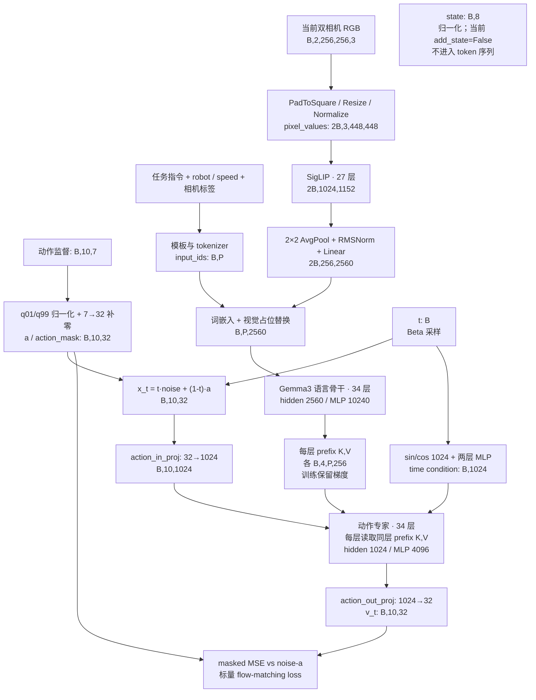
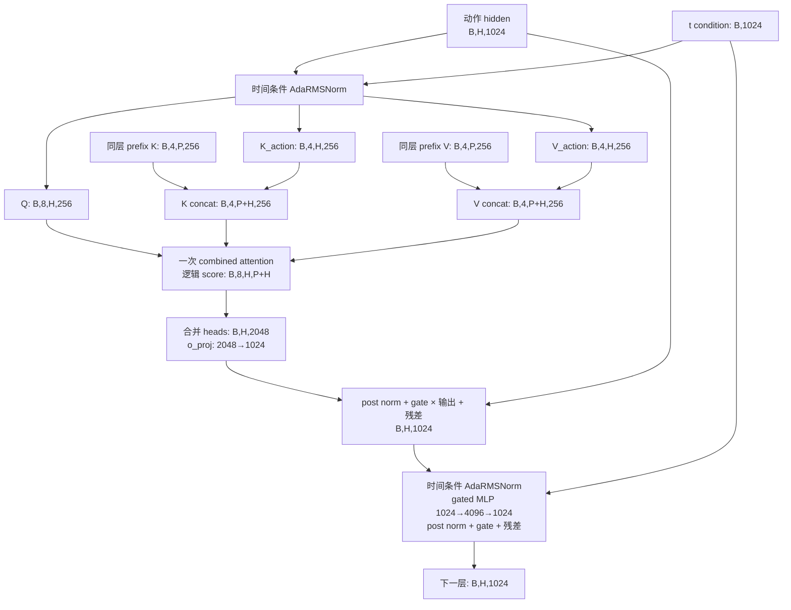
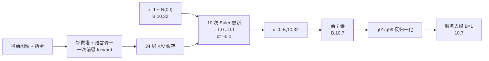

# DM0.5 模型结构与张量维度（本地 DM05-libero）

本文按 [Fast-WAM 架构说明](../literature/01_w0_fastwam_model_architecture.md) 的方式，
展开前向路径、维度、注意力、参数和训练状态。对象是**我们实际运行的 DM05-libero**，
不是把 DM05、DM05-MEM、RoboTwin 等配置混在一起。

证据固定为 OpenDM `fbab441b63c789e5c37f7293e61fea9ed356c6c5`、Transformers `5.3.0`、
checkpoint `25a8e0d38a8eaeaae41a44d7b4a2378fd8ce1088`。关键形状通过真实权重前向 hook
核对；训练路径仅作 `Smoke / no_grad forward`，未执行 backward 或 optimizer step。

## 先看结论

- **视觉语言前缀 + 动作专家**：SigLIP 视觉编码器接 Gemma3 语言骨干，再由独立动作专家
  读取语言骨干每一层的 K/V，输出连续动作速度场。
- **不生成未来视频**：当前路径没有视频 VAE、视频去噪分支或视频重建 loss。
- **两张图各变成 256 个视觉 token**：448×448 → 32×32 patches → 16×16 pooled tokens。
- **前缀 hidden=2560，动作 hidden=1024**；但双方均为 8 个 Q heads、4 个 KV heads、
  head dim=256，因而可以直接复用逐层 K/V。
- **LIBERO 动作是 7D，内部容器是 32D**；chunk 为 10，最终输出 `[B,10,7]`。
- **当前 `add_state=False`**：HTTP 接收 8D state，但它不会进入当前模型的状态 token；
  不能把接口中出现 state 解读为存在一个 8→hidden 的 proprio encoder。

## 1. 符号、配置和输入输出契约

| 符号 | 含义 | 当前配置 |
| --- | --- | --- |
| `B` | 模型 batch size | 服务为 1；训练可配置 |
| `N` | 当前相机数量 | 2，Head / Left wrist |
| `P` | 前缀总 token 长度，含图像占位 token、文字、特殊符号、padding | 推理随指令变化；探针为 564；训练默认 1024 |
| `T` | 非视觉 token 数，含文本和模板符号 | 本次探针 52，因此有效前缀为 `2×256+52=564` |
| `H` | 动作块时间长度 | 10 |
| `D` | 实际动作维度 | 7 |
| `D_shared` | 内部统一动作维度 | 32 |
| `L` | 语言骨干与动作专家的层数 | 各 34 层 |
| `S` | Flow Matching 推理积分步数 | 默认 10；与 `H=10` 是两个独立参数 |

**checkpoint 的 `config.json` 写着 `chunk_size=50`，本地 LIBERO entry 在加载前将它
覆盖为 10。** 只看权重配置文件会误读真实执行的 horizon。`action_dim=32` 则保留。
训练 `model_max_length` 从 trainer 传入，实际为 1024；不能把某个函数签名中的 768
默认值当成本次训练 batch 的长度。

### 环境 / HTTP 层

| 字段 | 单次请求 / 返回形状 | 含义 |
| --- | --- | --- |
| `observation.images["1"]` | 解码后 `[256,256,3]`，uint8 RGB | agentview；本地闭环先双轴翻转 |
| `observation.images["2"]` | 解码后 `[256,256,3]`，uint8 RGB | wrist；相同翻转 |
| `observation.prompt` | 字符串 | 任务指令 |
| `observation.state` | `[8]` | EEF position 3 + quaternion 转 axis-angle 3 + 两指关节位置 2 |
| `observation.robot_type` | 字符串 | Franka；用于元信息和归一化选择 |
| `actions` | `[10,7]`，JSON 没有 batch 维 | 6D 末端控制 + 1D 连续夹爪 |

LIBERO 客户端取动作块的 10 步顺序执行，再用新观测请求下一块。仿真控制频率为 20Hz，
所以 10 步覆盖 0.5s 仿真时间；这不等于推理服务已经具备实机 20Hz 闭环能力。

上游 `ActionMode.ABSOLUTE` 在此表示直接读取数据中的 action 字段、无需由 state 差分
生成监督。**它不意味着输出是世界坐标中的绝对位姿**；具体控制含义由 LIBERO
`OSC_POSE` 接口及原始示教动作决定，不能再凭枚举名称额外做一次位姿积分。

## 2. 训练前向总图



纯文本主路径：

```text
图像 [2B,3,448,448]
  → patch conv [2B,1152,32,32]
  → flatten + position embedding [2B,1024,1152]
  → 27 层 SigLIP [2B,1024,1152]
  → 2×2 空间池化 [2B,256,1152]
  → RMSNorm + 1152→2560 [2B,256,2560]
  → 替换文本序列中的图像占位 [B,P,2560]
  → 34 层语言骨干 → 34 组 K/V，各 [B,4,P,256]
                                           │
带噪动作 [B,10,32] → 32→1024 [B,10,1024] ──┤
时间 t [B] → sin/cos + MLP [B,1024] ────────┤
                                           ↓
                         34 层动作专家 [B,10,1024]
                                           ↓
                              1024→32 [B,10,32]
                                           ↓
                    训练：masked FM loss；推理：Euler 更新
```

## 3. 图像如何变成视觉语言前缀

### 3.1 预处理与视觉编码器

`NoAugmentationPipeline` 仍会做 PadToSquare 和 Resize(448,448)，并非完全不处理图像。
Gemma3 processor 随后执行像素 rescale `1/255`，mean/std 均为 0.5 的归一化，转 CHW。
无随机裁剪的当前双相机配置中，图像以 `[B×N,3,448,448]` 进入视觉编码器；
**两张图按图像 batch 维排列，不像 FastWAM 那样横向拼成一张宽图。**

| 步骤 | 输入 → 输出 | 说明 |
| --- | --- | --- |
| Patch embedding | `[2B,3,448,448] → [2B,1152,32,32]` | Conv2d，kernel=stride=14，448/14=32 |
| Flatten + 位置嵌入 | `[2B,1152,32,32] → [2B,1024,1152]` | 32×32=1024；没有额外 CLS token |
| SigLIP encoder | `[2B,1024,1152] → 同形状` | 27 层；16 heads，每 head 72 维；MLP 4304 |
| Post layer norm | `[2B,1024,1152] → 同形状` | 输出最后一层视觉特征；vision_use_head=False |
| 多模态池化 | reshape 到 `[2B,1152,32,32]` → `[2B,1152,16,16]` | 2×2 AvgPool，stride=2 |
| Flatten + RMSNorm | `[2B,1152,16,16] → [2B,256,1152]` | 每相机 256 个 token |
| 多模态投影 | `[2B,256,1152] → [2B,256,2560]` | 权重矩阵 `[1152,2560]` |

SigLIP 一层内部是标准视觉 self-attention：Q/K/V 各由 1152 投影到 1152，
reshape 为 `[2B,16,1024,72]`；随后 attention、输出投影、残差与两层 MLP
`1152→4304→1152`。视觉塔不是动作专家，也不负责生成动作。

### 3.2 文本与图像 token 的拼接

`ChatTokenization` 组织机器人类型、speed、任务、相机标签、图像和对话模板。
processor 为每张图预留 256 个视觉占位 token；文本词嵌入为 `[B,P,2560]`，
视觉特征通过 `masked_scatter` 替换对应位置。替换不再增加序列长度。

```text
input_ids                 [B,P]          int64
attention_mask            [B,P]          int64，标识有效 / padding
token_type_ids            [B,P]          int64，区分图像块与普通文本
pixel_values              [2B,3,448,448]  processor 输出 float32

scaled token embedding    [B,P,2560]
image features            [2B,256,2560]
merged inputs_embeds      [B,P,2560]
```

词嵌入层按 Gemma3 实现乘 `sqrt(2560)`；图像位置随后被多模态投影结果替换。
当前示例有效 `P=564=512+52`，但 **564 不是模型常数**。指令、模板、机器人字段、
state/history 开关变化都可能改变长度。

训练 collator 将每个样本补齐到 1024，得到 `[B,1024]`；图像仍是 `[2B,3,448,448]`，
并不会为 padding 再添加图像。长输入会先尝试缩短任务文本，collator 仍有截断兜底，
不能无条件假定任意长输入都能保持图像占位完整。

### 3.3 8D state 到底去哪了

本次 LIBERO entry 配置 `add_state=False`、`is_history=False`。state 在接口中仍需提供，
会做维度检查、归一化；但 `ChatTokenization` 不生成 `States:` 字段。
模型的当前 forward 不存在额外 state projection，`inference_action` 签名中的
`states` 参数也没有在这条路径用于动作预测。当前输出变换亦不使用 state 做相对位姿合成。

所以在**当前固定配置**中，8D state 不是动作网络的有效条件。
本次探针改变合成 state、保持其他字段相同，得到相同 input_ids，与源码结论一致。
这不表示所有 DM05 配置都忽略状态。

一般配置 `add_state=True` 时，状态路径是：

```text
state [B,d_state]
 → q01/q99 归一化到约 [-1,1]
 → 每维量化到 0…255 的整数
 → 拼成 States 文本
 → tokenizer 产生若干 token
 → 共享语言词嵌入 [B,P,2560]
```

整数的文本 token 数不保证与 state 维数相等；它不是 FastWAM 的单个 proprio token。

## 4. Gemma3 语言骨干与逐层 K/V

| 配置项 | 语言骨干 | 动作专家 |
| --- | ---: | ---: |
| 层数 | 34 | 34 |
| Hidden size | 2560 | 1024 |
| MLP intermediate size | 10240 | 4096 |
| Q heads | 8 | 8 |
| KV heads | 4 | 4 |
| Head dim | 256 | 256 |
| Q 总投影宽度 | 2048 | 2048 |
| K / V 总投影宽度 | 各 1024 | 各 1024 |
| 输入词表 / token embedding | 262208，embedding 宽度 2560 | 无 token embedding，输入是连续动作投影 |

**不要用 `hidden_size / num_heads` 推 head dim。** 当前配置显式指定 `head_dim=256`，
所以语言骨干 `2560→2048` 生成 Q，动作专家 `1024→2048` 生成 Q。

语言第 `l` 层：

```text
h_l                  [B,P,2560]
Q = q_proj(h_l)      [B,P,2048] → [B,8,P,256]
K = k_proj(h_l)      [B,P,1024] → [B,4,P,256]
V = v_proj(h_l)      [B,P,1024] → [B,4,P,256]
Q/K norm + RoPE      形状不变
GQA attention       KV 按 2 组扩展匹配 8 个 Q heads
attention output    [B,P,2048]
o_proj              2048→2560 → [B,P,2560]
gated MLP           两路 2560→10240，经 GELU 门控乘法，再 10240→2560
```

经过 34 层后，最后 hidden state 是 `[B,P,2560]`，但动作专家的条件不是简单地
把这个最终张量过一次 cross-attention；它读取的是**每一层各自的 K/V**：

```text
prefix_cache_keys   = (K_0, K_1, …, K_33)
prefix_cache_values = (V_0, V_1, …, V_33)
K_l / V_l          = [B,4,P,256]   # 当前短前缀范围
```

前缀层型为 29 个 sliding-attention 层和 5 个 full-attention 层；full 层的
零基索引为 5、11、17、23、29。sliding window=4096，当前 564 / 1024 长度低于窗口。
位置编码使用对应层型的 RoPE；动作配置必须匹配前缀的层数、层型、head 数和 RoPE 等，
源码有显式兼容性检查。超长前缀的动态滑窗缓存不能直接套用本表中的完整 P 长度。

### Prefix attention 不是全双向

Gemma3 的文本按 causal 规则看过去；同一连续图像块内部允许双向注意力。
后面的图像可以看前面的 token / 图像，前面的图像不会看未来图像。
还要叠加 padding mask 和层型窗口限制。

训练 cache 使用 `VLADynamicCache / OverwriteDynamicLayer`，保留 K/V 的计算图。
**前缀先算、动作后算，不代表训练时冻结前缀**：动作 loss 可以通过 K/V 回传到前缀。
本次没有实跑 backward，这一梯度连接结论来自源码的缓存与张量连接。

## 5. 一个动作专家层内部发生什么

### 5.1 时间与动作输入

归一化动作补到 `[B,H,32]`，经 `action_in_proj:32→1024` 得到 `[B,H,1024]`。
时间步是每个样本一个标量 `[B]`，不是每个动作时间位置一个独立 t：

```text
t [B]
 → sinusoidal embedding [B,1024]
 → Linear 1024→1024 → SiLU
 → Linear 1024→1024 → SiLU
 → adarms_cond [B,1024]
```

每层有两组独立的时间调制器：attention 前一组、MLP 前一组；最后再有一组 final
调制器。每组都是 `Linear 1024→3072`，切成 scale / shift / gate，各 `[B,1024]`，
广播为 `[B,1,1024]`。总共 `34×2+1=69` 组。

### 5.2 逐层注意力连接



严格顺序是：AdaRMSNorm → Q/K/V 投影 → Q/K norm → RoPE → K/V 拼接 → attention →
o_proj → post-attention norm → gated residual → AdaRMSNorm → gated MLP →
post-feedforward norm → gated residual。AdaRMSNorm 的实现按 RMS 标准化后施加
`(1+scale)` 和 shift，gate 用于残差支路；最终 norm 的 gate 返回值不参与后续残差。

| 动作第 l 层操作 | 形状 |
| --- | --- |
| 输入 / AdaRMSNorm 输出 | `[B,H,1024]` |
| Q 投影与 reshape | `[B,H,2048] → [B,8,H,256]` |
| K/V 投影与 reshape | 各 `[B,H,1024] → [B,4,H,256]` |
| 与前缀沿序列维 concat | 各 `[B,4,P+H,256]` |
| KV repeat 到 Q head 数 | 各 `[B,8,P+H,256]`，当前 SDPA 实现显式 repeat |
| 逻辑 attention scores | `[B,8,H,P+H]`；SDPA 不一定物化整张 score 矩阵 |
| attention mask | `[B,1,H,P+H]`，跨 head 广播 |
| attention 输出 | `[B,H,8,256] → [B,H,2048]` |
| o_proj | `2048→1024`，输出 `[B,H,1024]` |
| MLP 两支 gate/up | 各 `[B,H,4096]`，激活后逐元素乘 |
| MLP down | `[B,H,4096] → [B,H,1024]` |

双方权重独立；直接拼接的是注意力空间中的 K/V，**不是把 2560D hidden 强行接到
1024D hidden 后面**。也不是独立 self-attention 后再追加一个 cross-attention 模块。

### 5.3 Mask 和位置编号

用“行是 query，列是 key”表示整体信息可见性：

| Query \ Key | 视觉语言 prefix | 动作 suffix |
| --- | --- | --- |
| Prefix | Gemma3 causal + 同图像块双向 | 不读取动作 |
| Action | 全部有效 prefix，屏蔽 padding / history pad | 所有 H 个动作位置，双向 |

动作时间位置之间不使用下三角 causal mask；**一次并行预测整个动作块**。
动作专家虽然保留 sliding/full 层型以选择 RoPE，但其自定义 suffix mask 是上述全块
可见规则，不应把语言侧的滑窗规则直接搬到动作侧。

suffix position IDs 从有效 prefix token 数开始连续编号，而不是从补齐后的长度开始：
例如当前有效 prefix=564，训练虽然 pad 到 1024，动作位置仍从 564 开始。
训练 mask 宽度却仍是 `1024+10=1034`，其中 padding 列不可见。

## 6. Flow Matching 训练：监督、加噪、loss

### 6.1 动作准备

LIBERO 每个 JSONL 行有当前 action，`BuildActionChunk` 从当前帧开始取 H=10 步，
不是从下一帧开始。尾部不足时重复最后一个动作；这一路初始 action_mask 为全 True，
**并没有因为尾部重复而自动建立时间 padding mask**。

```text
单样本原始动作      [1,10,7]
q01/q99 归一化      [1,10,7]
PadAction(32)       [1,10,32]，最后 25 维补零
action_mask         [1,10,32]，最后 25 维为 False
TrainingCollator    [B,10,32]
```

分位数归一化先裁剪到 `[q01,q99]`，再用
`a_norm = 2·(a−q01)/(q99−q01+1e−6)−1`。同时为零的统计维度按实现特殊处理。
归一化维数是实际机器人动作维数，补到 32 在其后完成。

### 6.2 加噪与目标

对每个样本：

```text
noise ε ~ N(0,I)                        [B,H,32]
t = 0.999 × Beta(1.5,1.0) + 0.001      [B]
x_t = t × ε + (1−t) × a                [B,H,32]
x_t = x_t × action_mask                [B,H,32]
target u_t = ε − a                     [B,H,32]
predicted v_t = ActionExpert(x_t,t,KV)   [B,H,32]
```

这里 `t≈1` 是噪声端，`t≈0` 是干净动作端。一次训练 forward 采样一次 t、调用一次动作
专家，并不执行推理时的 10 次积分。target 是速度场，**不是直接回归干净动作，也不是
把连续动作逐维编码成语言 token 再做交叉熵**。

先对每个样本有效动作元素计算平均 MSE，再对 batch 求平均：

```text
loss_i = sum_{h,d} mask[i,h,d] × (v_t−u_t)^2
         / sum_{h,d} mask[i,h,d]
loss = mean_i(loss_i)
```

正常 LIBERO 样本分母是 `10×7=70`；本地 forward 返回标量 loss 和 fm_loss，
`logits=None`。本路径没有语言交叉熵或未来图像监督。

## 7. 推理：前缀算一次，动作积分 10 次



每个积分步执行 `x_t ← x_t + v_t·dt`，然后 `t ← t+dt`。下一个步开始前重新将未使用的
动作通道乘 mask；最终服务仅取前 7 维并反归一化。因此未使用通道的最终中间值不应被
视为可执行动作，也不必假定它们在最后一次 Euler 更新后仍严格为零。

固定一次观测时，视觉塔与语言骨干不随每次动作积分重复运行，34 组 prefix K/V 被复用；
下一次环境观测到来时重新算 prefix，不是跨 episode 无限复用。

本机默认后端还有 suffix CUDA Graph 优化：首个形状请求 eager，第二个请求尝试捕获，
随后复用；prefix 长度按 16 向上取整。564 对应 bucket 576，因此 Graph 内的 mask 宽度
会变成 `576+10=586`，多出的 prefix padding 不可见。本文 hook 探针明确关闭 Graph，
避免把 bucket padding、捕获和模型固有维度混淆；不以探针计时替代正常运行延迟。

### dtype 也有变化

本地权重以 BF16 加载，但并非每个算子和张量都为 BF16：

| 张量 / 路径 | 本次 eager 探针 dtype |
| --- | --- |
| processor pixel_values | FP32；进入视觉 patch conv 前转为权重 dtype |
| input_ids / position_ids | int64 |
| 视觉、语言 hidden、prefix K/V、动作 hidden | BF16 |
| action_in_proj | helper 用 FP32 计算，再转 BF16 hidden |
| action_out_proj | helper 用 FP32 计算，输出 `[B,H,32]` FP32 |
| eager 推理最终动作 | FP32；服务也显式转 FP32 后导出 |
| 训练 action / mask | FP32 / bool |

CUDA Graph / fast 后端有专门的实现，不能把这个 eager dtype 表直接当作所有后端的
逐算子精度说明。

## 8. 参数拆分、初始化与微调范围

以下是本地加载后按 `named_parameters()` 去重计数，且与 checkpoint 张量数量核对。
这里统计参数存储，不表示每一个参数都在当前动作 forward 中被调用。

| 组件 | 参数量 | 当前动作路径中的角色 |
| --- | ---: | --- |
| SigLIP 视觉塔 | 413,327,088 | 当前图像特征 |
| 多模态 projector | 2,950,272 | 池化、归一化和 1152→2560 |
| 语言 token embedding | 671,252,480 | 262208×2560；默认 FT 配置冻结 |
| 语言 34 层及末端 norm | 3,209,010,688 | 生成逐层 prefix K/V |
| 语言 lm_head | 671,252,480 | 存在于 checkpoint，但当前动作路径不调用 |
| 动作 34 层及 norm，不含时间调制器 | 641,886,208 | 动作 suffix 处理 |
| 动作时间调制器 | 217,267,200 | 69 组 1024→3072 |
| action_in_proj | 33,792 | 32→1024，含 bias |
| action_out_proj | 32,800 | 1024→32，含 bias |
| time_mlp_in + time_mlp_out | 2,099,200 | 两组 1024→1024，含 bias |
| **合计** | **5,829,112,208** | **约 5.829B** |

**参数共享陷阱：** config 声明了 tied embeddings，但本地 checkpoint 同时保存 embedding
和 lm_head；Transformers 加载时提示不绑定，本次 `data_ptr()` 检查也确认二者未共享
存储。因此不能按“通常 Gemma 会 tie”直接减掉 0.671B，更不能把“DM0.5”理解成 0.5B。

所有上述模块在本次运行中都从 **DM05-libero 完整 checkpoint** 加载，包括动作专家；
没有临时随机初始化一个动作头来驱动闭环。这个 checkpoint 不能单独证明原始预训练
阶段动作专家如何初始化，不能照搬 FastWAM 的权重插值初始化叙述。

### 全量 FT 与 LoRA

- 全量模式的默认 `freeze_vlm_embedding=True` 冻结词嵌入，视觉 / 语言层 / 动作专家
  并非默认全冻。动作 loss 的梯度可沿 prefix K/V 回传；“cache”不等于“detach”。
- `lm_head` 在此动作前向不被调用；默认冻结函数只显式遍历 embedding。由于本次权重
  未绑定，不应按源码注释就声称 lm_head 同步冻结。`requires_grad=True` 也不保证有梯度。
- 官方 LoRA 默认 `r=32, alpha=16, dropout=0`，作用于支持的线性层，排除 lm_head；
  同时以 dense 参数训练/保存 action_in/out、time_mlp_in/out 和全部时间调制器。
- 时间调制器本身约 217M 参数，因此该 LoRA 配方不是“只训练几个很小的 adapter”。
  单卡训练显存需包括其梯度、优化器状态和激活，不能由 11GiB 推理显存直接推断。
- 本地已经验证的是推理及一次训练形状 forward；**尚未验证 LoRA backward、保存恢复或
  正式训练收敛**。

## 9. 可选历史图像路径：当前未开启

源码支持 history，但本地 LIBERO 默认关闭。下面是源码推导，未进行历史输入实测：

```text
M 张有效历史图像
 → [M,3,448,448]
 → 同一视觉塔与多模态 projector [M,256,2560]
 → reshape 为 16×16 空间网格
 → adaptive_avg_pool2d 到 4×4
 → [M,16,2560]
 → 替换 prefix 中每帧 16 个 <unused0> 占位
```

无效历史 slot 用 `<unused1>` 填充，embedding 置零，attention 和位置计数屏蔽。
M 是一个 batch 中有效历史图像的总数；它们不与当前相机的 `pixel_values` 混作同一个
字段，而使用 `history_pixel_values` 和 `history_mask`。
这会增加前缀长度与算力成本，但仍然是观测历史条件，不是未来视频生成。
要使用此路径，需选匹配的配置 / checkpoint，不能把打开开关等同于已获得可靠记忆能力。

## 10. 与 FastWAM 对照

| 项目 | 本地 DM05-libero | 参考文档中的 W0 FastWAM |
| --- | --- | --- |
| 视觉输入处理 | 独立相机图像 → SigLIP tokens | 双相机横向拼接视频 → Wan VAE latent |
| 视觉输出监督 | 无未来视频 loss | 可联合训练视频与动作去噪 |
| 语言 | 在线 tokenizer + Gemma3 前缀 | 预计算 T5 context |
| 状态 | 此配置不加入 tokens | proprio_encoder 生成额外 context token |
| 耦合方式 | 前缀逐层 KV 供动作 suffix 读取 | 两专家 Q/K/V 沿序列拼接做混合注意力 |
| 当前任务的层数 | 前缀与动作各 34 | 视频与动作各 30 |
| 主要 hidden | 语言 2560，动作 1024 | 视频 3072，动作 1024 |
| 动作块 | 10×7，内部补成 10×32 | 参考配置 32×7 |
| 推理复用 | 一次观测的 prefix KV 复用到多次动作积分 | 以对应 FastWAM 推理配置为准 |

这些对比是结构与当前配置的差别，不是模型优劣结论。

## 11. 形状探针实测与复现

### 实验目标与思路

验证关键模块真实输入输出形状、参数存储以及状态 token 开关。
加载原权重，用双相机合成输入跑一次完整 10 步动作积分，再用 collator 生成长度 1024 的
训练输入，执行 train-mode 的 no_grad forward。只记录 shape、dtype、计数和有限性，
不保存原始图像、动作预测或中间特征。关闭 CUDA Graph；不执行训练更新。

### Smoke 实测

| 张量 | 推理探针 | 训练 forward 探针 |
| --- | --- | --- |
| input_ids | `[1,564]` | `[1,1024]` |
| pixel_values | `[2,3,448,448]` | `[2,3,448,448]` |
| SigLIP 输出 | `[2,1024,1152]` | 同左 |
| 多模态投影输出 | `[2,256,2560]` | 同左 |
| 语言最后 hidden | `[1,564,2560]` | `[1,1024,2560]` |
| 每层 prefix K/V | `[1,4,564,256]` | `[1,4,1024,256]` |
| 动作 hidden | `[1,10,1024]` | 同左 |
| 动作 attention mask | `[1,1,10,574]` | `[1,1,10,1034]` |
| 速度场输出 | `[1,10,32]` | 同左 |
| 终点 | 有限的 `[1,10,32]` 内部动作 | 有限标量 loss；无反向传播 |

### 完整命令

前置条件为[本地运行指南](README.md)中已完成的独立环境、源码与权重。

```bash
mkdir -p outputs/dm05/architecture
set -o pipefail
PYTHONNOUSERSITE=1 outputs/dm05/env/bin/python \
  src/robot_practice/experiments/dm05_architecture_probe.py \
  --opendm-dir outputs/dm05/opendm \
  --checkpoint outputs/dm05/checkpoints/DM05-libero \
  --output outputs/dm05/architecture \
  2>&1 | tee outputs/dm05/architecture/run.log
```

结果落点：`outputs/dm05/architecture/shapes.json`、`progress.log`、`run.log`。
判断标准：`DONE phases=3/3`、动作形状 `[1,10,32]` 且有限、loss 为有限标量；
输出还应明确 `backward_executed=false` 和 `optimizer_step_executed=false`。
出现 OOM、缺失本地权重、非有限输出或配置不一致应停止，不自动下载模型或改变训练策略。

### 证据边界

- **配置 / 源码事实**：层数、hidden/head 配置、mask 构造、FM 公式、训练开关与数据变换。
- **本次 Smoke 实测**：上表 B=1 的形状、checkpoint 参数计数、未共享 embedding/head、
  state 变化不改变当前 input_ids、一次训练 forward 返回有限 loss。
- **推导**：一般 B 下的形状、attention score 的逻辑矩阵、历史分支维度、梯度回传关系。
- **未验证**：backward 数值与显存、LoRA 训练稳定性、历史模式、长上下文、不同后端精度等价。
- 本文不是正式评测报告；先前单任务闭环结果见[本地验证记录](../../daily/2026-09-21-DM0.5本地推理与LIBERO闭环验证.md)。

## 12. 源码定位

| 要查的内容 | 固定版本源码 |
| --- | --- |
| 动作专家、训练 forward、推理积分、prefix cache | [dm05_arch.py](https://github.com/dexmal/opendm/blob/fbab441b63c789e5c37f7293e61fea9ed356c6c5/opendm/model/dm05/dm05_arch.py) |
| KV 兼容检查、可微 cache、suffix mask、时间编码 | [dm05_utils.py](https://github.com/dexmal/opendm/blob/fbab441b63c789e5c37f7293e61fea9ed356c6c5/opendm/model/dm05/dm05_utils.py) |
| 图像 / state tokenization、动作归一化与 padding | [transforms.py](https://github.com/dexmal/opendm/blob/fbab441b63c789e5c37f7293e61fea9ed356c6c5/opendm/data/transforms.py) |
| batch 拼接与长度补齐 | [collator.py](https://github.com/dexmal/opendm/blob/fbab441b63c789e5c37f7293e61fea9ed356c6c5/opendm/data/collator.py) |
| LIBERO 的 chunk=10 / add_state=False | [dm05_libero.py](https://github.com/dexmal/opendm/blob/fbab441b63c789e5c37f7293e61fea9ed356c6c5/playground/dm05_libero.py) |
| 服务输入输出、模型加载、默认参数 | [dm05_exp.py](https://github.com/dexmal/opendm/blob/fbab441b63c789e5c37f7293e61fea9ed356c6c5/opendm/exp/dm05_exp.py) |
| LoRA target/modules_to_save | [dm05_lora.py](https://github.com/dexmal/opendm/blob/fbab441b63c789e5c37f7293e61fea9ed356c6c5/opendm/model/dm05/dm05_lora.py) |
| Gemma3 projector、QKV、图像块 attention mask | [Transformers v5.3.0 modeling_gemma3.py](https://github.com/huggingface/transformers/blob/v5.3.0/src/transformers/models/gemma3/modeling_gemma3.py) |
| 实际权重配置 | [checkpoint config.json](https://huggingface.co/Dexmal/DM05-libero/blob/25a8e0d38a8eaeaae41a44d7b4a2378fd8ce1088/config.json) |
