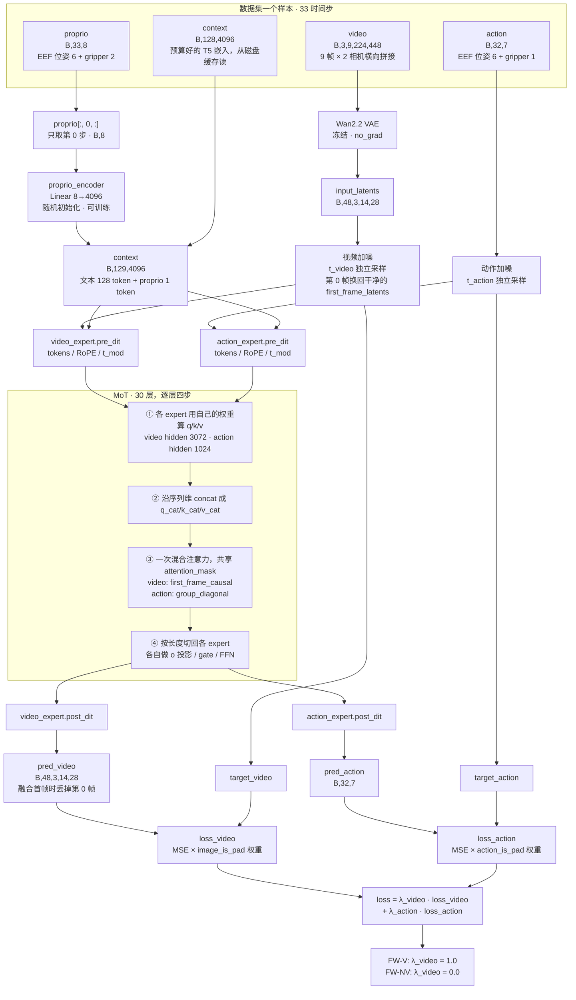

# Fast-WAM 模型结构（W0 训练配置）

对应 `configs/task/libero_uncond_2cam224_1e-4.yaml` + `configs/model/fastwam.yaml` +
`configs/data/libero_2cam.yaml`，代码位于 vendored `FastWAM/src/fastwam/models/wan22/`。

VS Code 的 Markdown 预览（`Ctrl+Shift+V`）自带 mermaid 渲染。若不渲染，往下看同一张图的
纯文本版本。

## 训练时的前向路径



## 纯文本版

```
┌─────────────── 数据集一个样本（33 时间步）────────────────┐
│ video   [B,3,9,224,448]   9 帧 × 2 相机横向拼接 224×448   │
│ action  [B,32,7]          EEF 位姿(6) + gripper(1)       │
│ proprio [B,33,8]          EEF 位姿(6) + gripper(2)       │
│ context [B,128,4096]      预算好的 T5 嵌入（磁盘缓存）     │
└──────────────────────────────────────────────────────────┘
     │            │            │                 │
     ▼            │            ▼                 │
┌──────────┐      │   ┌────────────────┐         │
│Wan2.2 VAE│      │   │ proprio[:,0,:] │         │
│ 冻结      │      │   │  只取第 0 步    │         │
└────┬─────┘      │   └───────┬────────┘         │
     ▼            │           ▼                  │
input_latents     │   ┌────────────────────┐     │
[B,48,3,14,28]    │   │ proprio_encoder    │     │
     │            │   │ Linear 8→4096      │     │
     │            │   │ 随机初始化           │     │
     │            │   └────────┬───────────┘     │
     │            │            └────────┬────────┘
     │            │                     ▼
     │            │           context [B,129,4096]
     ▼            ▼                     │
┌─────────────────────┐ ┌───────────────┴──────┐
│ 视频加噪 t_video     │ │ 动作加噪 t_action     │
│ ★第 0 帧换回干净的   │ │                      │
│ → target_video      │ │ → target_action      │
└──────────┬──────────┘ └──────────┬───────────┘
           ▼                        ▼
  video_expert.pre_dit    action_expert.pre_dit
           └───────────┬────────────┘
                       ▼
   ╔═══════════ MoT · 30 层，逐层四步 ═══════════╗
   ║ ① 各 expert 用自己的权重算 q/k/v            ║
   ║    video 3072 / action 1024                ║
   ║ ② 沿序列维 concat                           ║
   ║ ③ 一次混合注意力，共享 attention_mask        ║
   ║ ④ 切回各 expert，各自 o 投影 / gate / FFN   ║
   ╚═══════════════════╤════════════════════════╝
          ┌────────────┴────────────┐
          ▼                          ▼
  video_expert.post_dit    action_expert.post_dit
          │                          │
     pred_video                 pred_action
   [B,48,3,14,28]                [B,32,7]
          │                          │
          ▼                          ▼
   MSE vs target_video       MSE vs target_action
   × image_is_pad            × action_is_pad
          │                          │
     loss_video                 loss_action
          └────────────┬─────────────┘
                       ▼
    loss = λ_video · loss_video + λ_action · loss_action
           FW-V: λ_video = 1.0 ／ FW-NV: λ_video = 0.0
```

## 权重来源与训练状态

| 组件 | 参数量 | 初始化来源 | 训练 |
| --- | ---: | --- | --- |
| Video DiT（Wan2.2-TI2V-5B，30 层，hidden 3072） | 约 5.0 B | Wan 官方预训练 | 是 |
| ActionDiT 主干（30 层，hidden 1024） | 1.02 B | **由 Wan 视频 DiT 权重 1-D 线性插值 + alpha 缩放导出** | 是 |
| ActionDiT `action_encoder`（Linear 7→1024） | 约 7 K | 随机 | 是 |
| ActionDiT `head`（Linear 1024→7） | 约 7 K | 随机 | 是 |
| `proprio_encoder`（Linear 8→4096） | 约 33 K | 随机 | 是 |
| Wan2.2 VAE | — | Wan 官方预训练 | **冻结**（`@torch.no_grad()`） |
| T5 umt5-xxl text encoder（11 GB） | — | 有权重但 `load_text_encoder: false`，**不加载** | 不参与 |

可训练合计约 **6.02 B**。冻结逻辑在 `trainer.py:287`：先 `model.requires_grad_(False)` 全冻，
再放开 `model.dit`（即 `self.mot`，内含两个 expert）与 `proprio_encoder`。

ActionDiT 初始化的依据来自权重文件自带的 `policy` 字段：

```
skip_prefixes:  ['action_encoder.', 'head.']
alpha_scaling:  True
interpolation:  'sequential_1d_linear_align_corners_true'
```

所以它既不是随机，也不是在机器人动作上预训练过——是**从视频预训练权重数学导出的初始化**。
`skip_prefixes` 列出的两个模块保持随机初始化。

## 三个容易看漏的设计点

**两个 expert 权重完全独立，只通过注意力耦合。** 各有一整套 30 层权重，唯一交汇点是第 ②③ 步
把两串 token 拼起来做一次注意力再切开。所以「动作能看到画面的哪些部分」完全由
`attention_mask` 决定：video 用 `first_frame_causal`，action 用 `group_diagonal`。

**视频和动作各用独立的 timestep。** 同一次前向里视频可能噪声很重而动作很轻，或反过来。这是
刻意设计，让模型在任意噪声组合下都能互相利用。

**`λ_video = 0` 不等于冻结视频分支。** video expert 仍完整前向、其 token 仍进混合注意力，
**动作损失的梯度仍会流回它的权重**。FW-NV 的正确读法是「没有视频重建监督」，不是「视频分支
不参与训练」。Node 6 smoke 里 `no_video` 的 `loss_video` 恒 `0.0000`，那是
`λ_video · loss_video` 这个乘积。

## 证据边界

除 `input_latents` 的形状外，所有形状与结构均直接来自配置文件或代码中的断言与
`raise ValueError` 检查。

`input_latents [B,48,3,14,28]` 是**推导值**，未实跑验证：`in_dim: 48`；Wan2.2 VAE 时间 4×
空间 16× 压缩；9 帧 →(9−1)/4+1=3，224/16=14，448/16=28。要确认实际形状或查看任意一层的真实
输出，用单进程 forward hook（不需要分布式，纯前向 bf16 约 12 GB，单卡可跑，断点可无限停留）。
