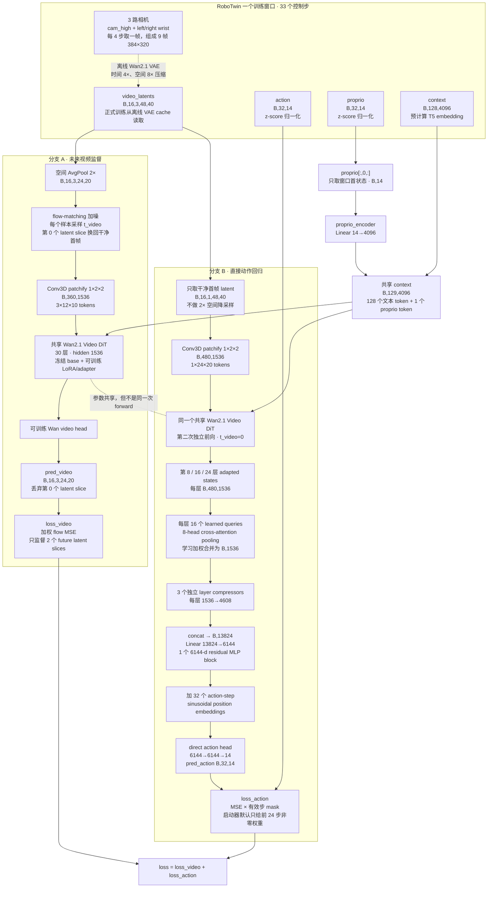

# Light-WAM 模型结构（RoboTwin 三相机训练配置）

本文对应以下实际组合：

- `configs/task/robotwin_uncond_3cam_384_1e-4.yaml`
- `configs/model/lightwam.yaml`
- `configs/data/robotwin.yaml`
- `scripts/train_robotwin.sh` 的默认覆盖参数
- vendored Light-WAM commit `b2785f6`

代码主体位于 `third_party/lightwam/Light-WAM/src/lightwam/models/wan22/`。本文描述的是
`scripts/train_robotwin.sh` 默认启动的 **Wan2.1 + WAM adapter + backbone LoRA +
StateFusionActionExpert** 路径，不是仍保留 ActionDiT 的兼容路径。

VS Code 的 Markdown 预览（`Ctrl+Shift+V`）可直接渲染下面的 Mermaid 图；若不渲染，后面还有
同一结构的纯文本版。

## 训练时的前向路径



## 纯文本版

```text
RoboTwin 窗口
├─ 三相机 × 33 控制步
│  └─ 每 4 步抽帧 → 9 帧 384×320
│     └─ 离线 Wan2.1 VAE → video_latents [B,16,3,48,40]
├─ action  [B,32,14]
├─ proprio [B,32,14] ──只取第 0 步──┐
└─ context [B,128,4096]              ├─→ context [B,129,4096]
                           Linear 14→4096

同一个 Wan2.1 Video DiT 被调用两次：

① 未来视频分支
   full video latents [B,16,3,48,40]
     → spatial avg-pool 2× [B,16,3,24,20]
     → flow-matching 加噪；第 0 个 latent slice 保持干净
     → patchify → 360 个 1536-d token
     → 30 层 Wan2.1 backbone + LoRA + layers 8/16/24 adapters
     → video head → [B,16,3,24,20]
     → 去掉首 latent slice，对两个 future slices 做 flow MSE

② 动作分支
   clean first-frame latent [B,16,1,48,40]
     → 不降采样，patchify → 480 个 1536-d token
     → 同一 backbone 的另一次 forward，video timestep 固定为 0
     → 取 layers 8/16/24 的 adapted token states
     → 每层 16-query learned pooling → [B,1536]
     → 每层压到 [B,4608]，三层 concat → [B,13824]
     → fusion/trunk → [B,6144]
     → 加 32 个 action-step 位置编码
     → direct MLP head → action [B,32,14]
     → action MSE；默认只有前 24 步获得直接监督

总损失 = 1.0 × loss_video + 1.0 × loss_action
```

## Adapter 与动作头内部结构

Video DiT 使用 Wan2.1-T2V-1.3B 的实际结构：30 层、hidden 1536、FFN 8960、12 个 attention
heads、每头 128 维。虽然 `configs/model/lightwam.yaml` 还保留了 Wan2.2 的通用默认值，模型加载器会
按 `video_backbone_type=wan2_1_t2v` 把这些字段覆盖成 Wan2.1 的结构。

每个选中层的 WAM adapter 都是一个零初始化残差瓶颈：

```text
h_l ── LayerNorm ── Linear 1536→256 ── GELU ── Linear 256→1536 ──┐
 │                                                               │
 └───────────────────────────────────────────────────────────────┴─→ h'_l
```

最后一个 Linear 的权重和 bias 都从零开始，所以初始时 `h'_l = h_l`。adapter 分别放在第
8、16、24 层之后，后续 backbone 层继续处理 `h'_l`。

代码同时缓存 `h_l`、`h'_l` 和 `delta_l = h'_l - h_l`，但当前 RoboTwin 配置是
`feature_sources: [adapted]`，StateFusionActionExpert **只读取 `h'_l`**。它虽然支持
`backbone` 或 `delta` 消融，默认模型没有把三者拼接起来。

LoRA 覆盖全部 30 层的以下线性映射：

```text
self-attention: q, k, v, o
cross-attention: q, k, v, o
FFN: input projection, output projection
rank = 64, alpha = 128, scale = 2
```

LoRA 的 up projection 从零开始，因此启用 LoRA 和 adapter 后，模型初始函数仍接近原始 Wan
backbone。

## 权重来源与训练状态

下表参数量由上述 RoboTwin 配置在 CPU 上实例化后计数。共享模块只计一次。

| 组件 | 参数量 | 初始化来源 | 训练状态 |
| --- | ---: | --- | --- |
| Wan2.1 Video DiT base（不含 LoRA、adapter、head） | 1,418,895,360 | Wan2.1-T2V-1.3B 官方权重 | **冻结** |
| Backbone LoRA（30 层、10 个 target/layer、rank 64） | 87,490,560 | down 随机、up 零初始化 | **训练** |
| WAM residual adapters（layers 8/16/24、1536→256→1536） | 2,373,888 | up projection 零初始化 | **训练** |
| Wan future-video head | 101,440 | Wan2.1 预训练权重 | **训练** |
| StateFusionActionExpert | 351,071,806 | 随机初始化 | **训练** |
| `proprio_encoder`（Linear 14→4096） | 61,440 | 随机初始化 | **训练** |
| 原始 ActionDiT | 0 | `remove_original_action_expert=true`，不实例化 | 不存在 |
| Wan2.1 VAE | 126,892,531 | Wan2.1 官方权重 | **冻结**；正式训练从 latent cache 读取 |
| T5 text encoder | 0（不加载） | 使用磁盘上的预计算 context | 不参与 |

模型加载参数总计约 **1.987 B**，其中约 **441.10 M** 可训练。这里的“Light”主要来自把 Fast-WAM
约 6 B 的双 expert 全量训练，改成 Wan2.1 小主干、PEFT 和直接动作头；它并不意味着动作头本身很小。

## 和 Fast-WAM W0 的结构差异

| 项目 | Fast-WAM W0 | 当前 Light-WAM RoboTwin |
| --- | --- | --- |
| 视频主干 | Wan2.2-TI2V-5B，hidden 3072 | Wan2.1-T2V-1.3B，hidden 1536 |
| ActionDiT | 30 层、约 1.02 B | **完全移除** |
| 视频—动作耦合 | 两个 expert 的 q/k/v 拼接后做 MoT mixed attention | 读取 Video DiT 第 8/16/24 层 adapted states |
| 动作生成 | action flow/diffusion，预测去噪目标 | 一次前向直接回归 32×14 action chunk |
| action timestep/noise | 有独立 `t_action` 和 noisy action | **没有** |
| 动作是否使用预测未来 | joint token path 中与视频 token 交互 | 不使用预测未来；只编码干净首帧 |
| 视频主干训练 | Video DiT 全参数训练 | base 冻结，只训练 LoRA、adapter 和 video head |
| 可训练参数 | 约 6.02 B | 约 441.10 M |

## 六个容易看漏的设计点

**动作不是 diffusion。** State-fusion 模式直接输出完整 action chunk；`action_scheduler`、随机 action
latent、action denoising steps 都不进入当前动作路径。推理接口即使接收 `seed` 和
`num_inference_steps`，在这个分支也会将它们丢弃。

**动作不读取模型预测的未来视频。** 每个训练 batch 对共享 Video DiT 做两次前向：一次看完整加噪
video latents 训练未来预测；另一次只看干净首帧产生动作。两个任务通过共享 LoRA/adapter 相互影响，
不是通过 `pred_video → action` 串联。

**未来分支和动作分支使用不同空间分辨率。** 未来分支先把 latent 的 48×40 降为 24×20，以减少
视频监督成本；动作分支保留首帧 48×40 latent，让 action expert 池化 480 个视觉 token。

**`freeze_backbone=true` 不等于视频网络完全不变。** 原始 Wan 参数冻结，但每层 LoRA、三个 residual
adapter 和 video head 都更新。视频损失与动作损失都会回传到共享 LoRA/adapter；只有 video head
仅受视频损失训练，StateFusionActionExpert 仅受动作损失训练。

**当前动作头只使用 adapted states。** 代码具备 `h`、`h'`、`delta` 三种 feature source，当前配置
只选 `h'`。不能把这次模型描述成 `[h,h',delta]` 三路融合。

**32 个输出动作里默认只直接监督前 24 个。** `scripts/train_robotwin.sh` 把 temporal weighting 覆盖为
`prefix_steps=24, prefix_weight=1, tail_weight=0`。后 8 步仍会计算出来，但 action loss 对它们没有
直接梯度；padding 位置还会被 `action_is_pad` 进一步屏蔽。

## 训练配置补充

`scripts/train_robotwin.sh` 默认使用 4 个进程、每进程 batch 16、梯度累积 2，因此默认有效全局 batch
是 128。优化目标为最多 500,000 optimizer steps，BF16、AdamW、初始学习率 `1e-4`、cosine
schedule、warmup 1,000 steps，每 5,000 steps 保存一次。正式路径使用离线 video latent cache 与
text cache，不会在每个训练 step 重新运行 VAE 或 T5。

## 源码锚点

- [Light-WAM 模型配置](../../../third_party/lightwam/Light-WAM/configs/model/lightwam.yaml)
- [RoboTwin 数据配置](../../../third_party/lightwam/Light-WAM/configs/data/robotwin.yaml)
- [RoboTwin 启动器](../../../third_party/lightwam/Light-WAM/scripts/train_robotwin.sh)
- [LightWAM 主前向](../../../third_party/lightwam/Light-WAM/src/lightwam/models/wan22/lightwam.py)
- [Wan Video DiT、adapter 与 LoRA](../../../third_party/lightwam/Light-WAM/src/lightwam/models/wan22/wan_video_dit.py)
- [StateFusionActionExpert](../../../third_party/lightwam/Light-WAM/src/lightwam/models/wan22/state_fusion_action_expert.py)
- [数据窗口与三相机拼图](../../../third_party/lightwam/Light-WAM/src/lightwam/datasets/lerobot/robot_video_dataset.py)

## 证据边界

参数量通过按当前配置实例化模块后直接计数，数据与中间 tensor 形状来自配置、VAE 压缩因子、patch
大小以及源码断言的联合推导。本文没有把一次真实 RoboTwin batch 送进 GPU forward hook，因此这些
形状属于**代码级静态核验**，不是运行时采样记录。

另外，基础 `configs/model/lightwam.yaml` 里的 action temporal weighting 默认关闭；本文采用正式
`scripts/train_robotwin.sh` 的覆盖值，所以写成“只直接监督前 24 步”。若启动时覆盖这些参数，应以
最终 Hydra resolved config 为准。
